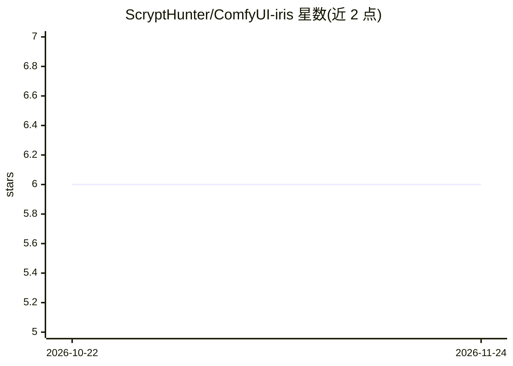

# ScryptHunter/ComfyUI-iris

⭐ 6 · Python · Apache-2.0 · 推送 2026-10-09 · [GitHub](https://github.com/ScryptHunter/ComfyUI-iris) · 个人维护

**在 ComfyUI 中运行 Iris-3B 生图/深度/修复的节点扩展**

为 ComfyUI 提供一组原生节点，接入 Sperid Labs 的 Iris-3B 权重，支持像素空间文本生图、实验性像素空间 Img2Img、相对深度估计与 4× 图像修复。生成走 ComfyUI 的 MODEL/ModelPatcher、conditioning、RGB LATENT 与采样器路径，文本编码使用 Comfy 兼容的 Qwen3-VL 4B 检查点。扩展不自动下载权重，需手动放置模型文件；仅新增 omegaconf 一个依赖。作者在 Windows 11 + RTX 4090 环境验证，Linux 及其他 ComfyUI 版本未经验证。

## 筛选速览

| 维度 | 判定 | 备注 |
|---|---|---|
| AI 角色 | `ai-native` | 本体是模型或模型工具 |
| 许可风险 | `permissive` | Apache-2.0 |
| 部署形态 | `desktop` | 安装包/桌面程序 |
| 模型依赖 | — | README 未给出锁定关系 |
| 硬件要求 | — | 无带数字的原话,不猜 |
| 安装摩擦 | `medium` | 含编译或系统依赖之一 |
| 成熟度 | — | 结构信号不足 |

## 能力要点

- 注册 10 个原生节点（Model Loader、Sigma Scheduler、Depth、Restore 4x 等），走 ComfyUI 原生采样路径
- 文本生图、实验性 Img2Img、相对深度、4× 修复四类工作流 JSON
- 不自动下载模型权重，使用 ComfyUI 已安装的本地检查点
- 仅新增 omegaconf>=2.3.0 依赖，PyTorch 等由 ComfyUI 提供

## 适用场景

- 在 ComfyUI 中用 Iris-3B 做文本生图
- 对输入图像做相对深度估计或 4× 修复
- 像素空间 Img2Img 实验工作流

## 场景标签

`图像生成` `图像视频处理` · 领域:内容生成

## 证据(README 行号)

> L3: Native ComfyUI nodes for Iris-3B pixel-space text-to-image, experimental image-to-image, relative depth, and image r
> L9: - **Text-to-image:** Qwen3-VL 4B through ComfyUI's standard **Load CLIP**, Iris conditioning, Iris sigmas, and nativ
> L80: - **Compatibility:** tested on Windows 11 with ComfyUI 0.39.0, Python 3.13, and an RTX 4090. Linux and other ComfyU

## 星数曲线

2026-10-22 6 → 2026-11-24 6（+0）

---
*卡片 v1 · prompt 1.4 · 生成 2026-11-20 · 置信度 high · 依据 README sha `84b5ec94d192` · [字段定义](../../DATASET.md)*
