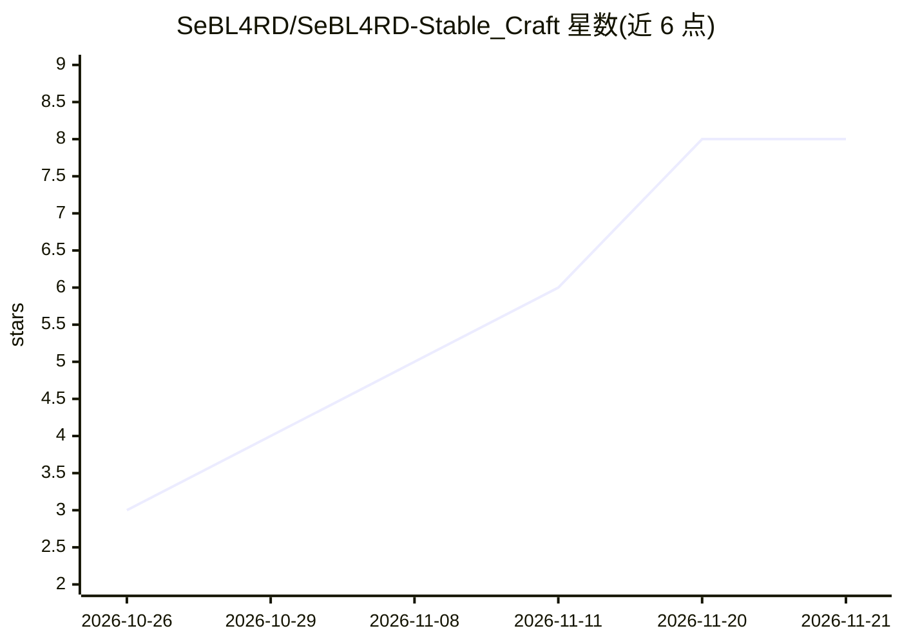

# SeBL4RD/SeBL4RD-Stable_Craft

⭐ 8 · Python · MIT · 推送 2026-11-19 · [GitHub](https://github.com/SeBL4RD/SeBL4RD-Stable_Craft) · 个人维护

**PhotoCraft 套索编辑伴侣：经 ComfyUI 本地生成图像到新图层**

StableCraft 是 PhotoCraft 的伴侣应用：在 PhotoCraft 中用套索选中区域、输入描述，经 ComfyUI 在本地 GPU 上生成编辑结果，以带遮罩的新图层插回。支持 EDIT/T2I 两种模式、每图层持久画廊、批量 16 张、XYZ 参数网格、LoRA 管理与按需模型下载器。通过 PhotoCraft 本地控制通道与 ComfyUI HTTP 接口驱动，两应用保持独立。仅支持 NVIDIA GPU，验证配置为 12 GB VRAM 与 32 GB RAM。

## 筛选速览

| 维度 | 判定 | 备注 |
|---|---|---|
| AI 角色 | `ai-native` | 本体是模型或模型工具 |
| 许可风险 | `permissive` | MIT |
| 部署形态 | `desktop` | 安装包/桌面程序 |
| 模型依赖 | local-ok | 支持本地模型 |
| 硬件要求 | — | 无带数字的原话,不猜 |
| 安装摩擦 | `low` | 无编译、无系统依赖或容器化 |
| 成熟度 | — | 结构信号不足 |

## 能力要点

- 套索→提示词→编辑→作为带遮罩羽化的新图层插入 PhotoCraft
- 6 个模型配置档案（FLUX.3/FLUX.2 Klein、Krea 2、Qwen Image 2.1、MOSS-Image），权重按需定位/下载
- XYZ plot 参数网格工具与每图层持久画廊、批量生成
- Windows .bat 安装器与 Linux install.sh（本地 venv）双平台安装

## 适用场景

- 在图像编辑器中对选区做局部重绘、物体移除、换背景
- 纯文本生图后自动遮罩插入图层（T2I 模式）
- 本地管理 LoRA 并批量对比采样参数（XYZ plot）

## 场景标签

`图像生成` `图像视频处理` · 领域:内容生成

## 证据(README 行号)

> L3: **Stable.art's lasso editing, inside PhotoCraft, powered by ComfyUI.**
> L7: on your own GPU, with ComfyUI as the generation engine.
> L24: - **two modes**: EDIT (source image) or T2I (text only), EDIT by default;

## 星数曲线

2026-10-26 3 → 2026-11-21 8（+5）

---
*卡片 v1 · prompt 1.4 · 生成 2026-11-20 · 置信度 high · 依据 README sha `d63fe7560279` · [字段定义](../../DATASET.md)*
