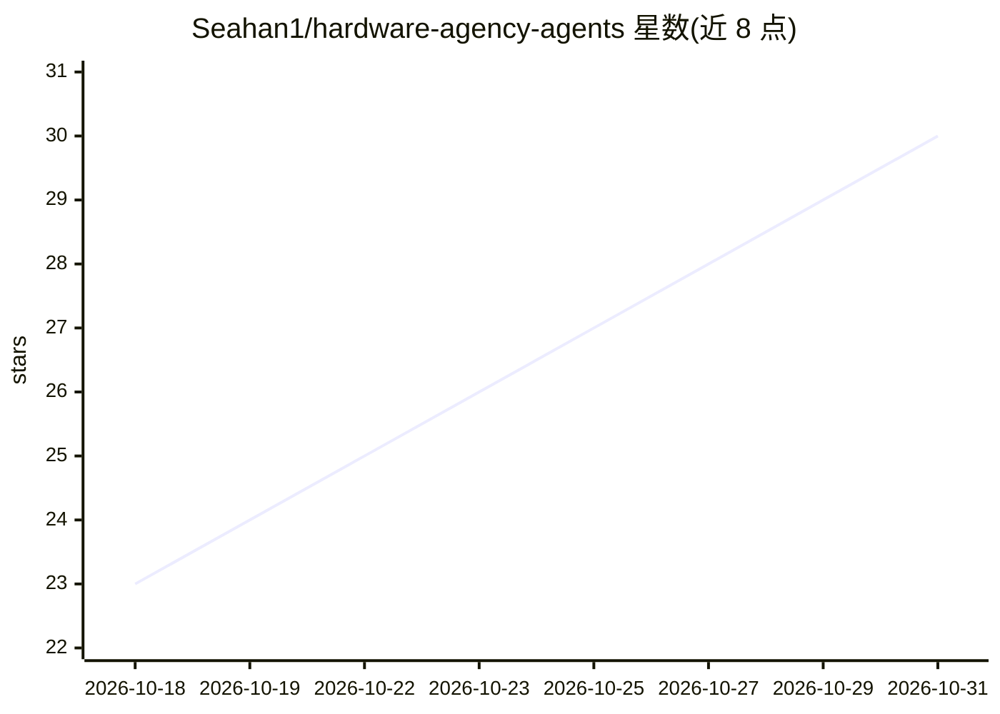

# Seahan1/hardware-agency-agents

⭐ 30 · Shell · MIT · 推送 2026-10-12 · [GitHub](https://github.com/Seahan1/hardware-agency-agents) · 个人维护 · 中文 README

**面向硬件工程师角色的 AI agent 技能文档库（47+16 条）**

按真实工程角色组织的硬件工程技能文档库：47 个硬件角色技能加 16 个硬件设计评审技能，覆盖 PCB 实现、嵌入式硬件、电源、EMC/合规、测试验证、SoC/FPGA 平台与通信接口共 8 个领域，每个 .md 文件定义角色边界、技术约束、工作流程与交付物。提供 install.sh 一键为 Codex 与 Claude Code 安装技能，中英文文档同步维护。仓库声明不隶属任何 agent 平台或 ST/TI/NXP 等厂商，结论仍需对照数据手册与标准验证。

## 筛选速览

| 维度 | 判定 | 备注 |
|---|---|---|
| AI 角色 | `ai-knowledge` | 知识聚合/清单类 |
| 许可风险 | `permissive` | MIT |
| 部署形态 | `None` |  |
| 模型依赖 | locked-api |  |
| 硬件要求 | — | 无带数字的原话,不猜 |
| 安装摩擦 | `low` | 无编译、无系统依赖或容器化 |
| 成熟度 | — | 结构信号不足 |

## 能力要点

- 47 个硬件角色技能 + 16 个设计评审技能，中英双语
- 覆盖 8 个工程领域（PCB/嵌入式/电源/EMC/验证/SoC-FPGA/通信）
- install.sh 脚本为 Codex 与 Claude Code 安装技能
- 技能可组合使用，跨域任务选主角色加辅助角色

## 适用场景

- 硬件设计评审前选择对应评审技能约束检查项
- STM32/电源/高速板等具体任务的 AI 辅助分析角色模板
- EVT/DVT 验证闭环与量产准备讨论的参考框架

## 场景标签

`提示工程` · 领域:Agent 开发

## 证据(README 行号)

> L14: `hardware-agency-agents` is an open-source library of hardware engineering skills organized by real engineering rol
> L67: - 47 hardware role skills plus 16 hardware design review skills with English and Chinese versions

## 星数曲线

2026-10-18 23 → 2026-10-31 30（+7）

---
*卡片 v1 · prompt 1.4 · 生成 2026-10-26 · 置信度 high · 依据 README sha `d6fa39e51ebc` · [字段定义](../../DATASET.md)*
