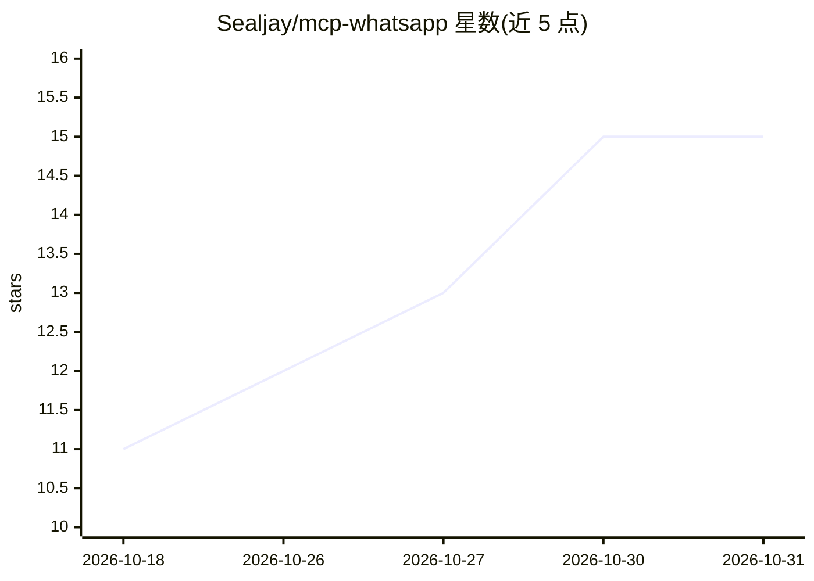

# Sealjay/mcp-whatsapp

⭐ 15 · Go · MIT · 推送 2026-10-17 · [GitHub](https://github.com/Sealjay/mcp-whatsapp) · [官网](https://sealjay.com) · 个人维护

**把个人 WhatsApp 账号以 42 个 MCP 工具暴露给 LLM 的 Go 单二进制服务器**

基于 whatsmeow 库封装个人 WhatsApp 账号的 MCP 服务器，以单二进制 Go 程序运行，在 127.0.0.1:8765 提供 HTTP 端点供 Claude Desktop、Cursor、Claude Code 等 MCP 客户端接入。暴露 42 个工具：消息收发与编辑撤回、群组管理、投票、媒体文件、屏蔽列表、隐私与在线状态等。消息缓存于本地 SQLite，仅在 agent 调用工具时传给模型；媒体访问限制在白名单根目录。由 lharries/whatsapp-mcp 分支重写而来，新增 LID 解析、发送消息持久化、按需历史回填等。限制：serve 停机期间超出 WhatsApp 保留窗口的历史会丢失。

## 筛选速览

| 维度 | 判定 | 备注 |
|---|---|---|
| AI 角色 | `ai-ecosystem` | LLM/agent 周边工具 |
| 许可风险 | `permissive` | MIT |
| 部署形态 | `self-host` | docker 或自建部署 |
| 模型依赖 | — | README 未给出锁定关系 |
| 硬件要求 | — | 无带数字的原话,不猜 |
| 安装摩擦 | `low` | 无编译、无系统依赖或容器化 |
| 成熟度 | — | 结构信号不足 |

## 能力要点

- 42 个工具覆盖消息、群组、投票、媒体、隐私等操作
- 单二进制 HTTP 守护进程，消息缓存在本地 SQLite
- LID 解析将 @lid JID 归一化为真实手机号
- 媒体文件访问被限制在 WHATSAPP_MCP_MEDIA_ROOT 白名单目录

## 适用场景

- 让 Claude Code/Cursor 等 MCP 客户端读写我的 WhatsApp 消息
- 通过 agent 查询聊天记录并代为回复、建群、发投票
- 把 WhatsApp 通知与消息纳入个人自动化工作流

## 场景标签

`工作流自动化` · 领域:效率与自动化

## 证据(README 行号)

> L13: A single-binary Go MCP server that wraps whatsmeow to expose a personal WhatsApp account to LLMs. `whatsapp-mcp ser
> L60: `serve` listens on `127.0.0.1:8765` (or `$WHATSAPP_MCP_ADDR`) and serves MCP at `/mcp`. It is stateless (no `Mcp-Se

## 星数曲线

2026-10-18 11 → 2026-10-31 15（+4）

---
*卡片 v1 · prompt 1.4 · 生成 2026-10-30 · 置信度 high · 依据 README sha `f65e85175bcd` · [字段定义](../../DATASET.md)*
