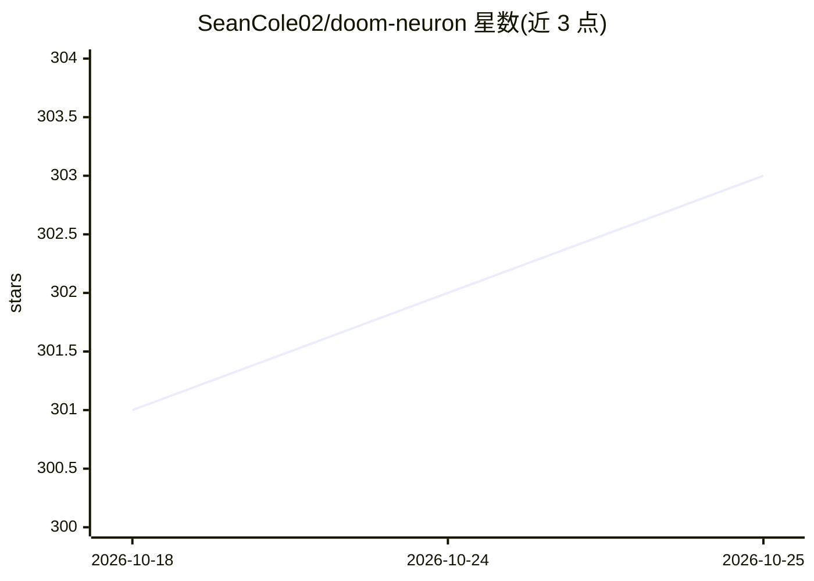

# SeanCole02/doom-neuron

⭐ 303 · Python · GPL-3.0 · 推送 2026-05-09 · [GitHub](https://github.com/SeanCole02/doom-neuron) · 个人维护

**用 CL1 生物神经元通过 PPO 学习玩 Doom 的实验代码**

强化学习研究代码：以 DishBrain CL1 生物神经元集群作为策略回路的一部分，PPO 训练的编码器将 Doom 画面转换为电刺激模式（频率/幅值/通道），CL1 输出脉冲经线性解码器映射为游戏动作；因脉冲不可微，编码器通过 REINFORCE 式策略梯度训练。README 提供默认超参、deadly corridor 课程、消融开关（随机/零脉冲）与同帧编码（实验性）说明，面向具备 CL1 硬件接口的研究者，本地训练服务器与硬件连接另见 USAGE.md。

## 筛选速览

| 维度 | 判定 | 备注 |
|---|---|---|
| AI 角色 | `ai-native` | 本体是模型或模型工具 |
| 许可风险 | `viral` | GPL-3.0 |
| 部署形态 | `library` | 以包/库形式分发 |
| 模型依赖 | — | README 未给出锁定关系 |
| 硬件要求 | — | 无带数字的原话,不猜 |
| 安装摩擦 | `medium` | 含编译或系统依赖之一 |
| 成熟度 | — | 结构信号不足 |

## 能力要点

- CL1 生物神经元输出脉冲经 0-bias 线性解码器直接决定游戏动作
- 编码器通过 PPO/REINFORCE 式策略梯度训练刺激模式
- 提供 deadly corridor 1–5 课程配置与消融测试开关（zero/random 脉冲）
- 同帧编码（raw/edge/contrast 多轮刺激）尚处实验阶段，未做消融验证

## 适用场景

- 复现生物神经元学习玩 Doom 的实验
- 调整刺激反馈参数研究 CL1 神经元可塑性
- 用消融模式验证脉冲信号对策略的贡献

## 场景标签

`强化学习` · 领域:训练与推理

## 证据(README 行号)

> L4: No, this is precisely why there are ablations. The footage you see in the video was taken using a 0-bias full linear
> L12: We train an encoder in our PPO policy that dictates the stimulation pattern (frequency, amplitude, pulses, and even

## 星数曲线

2026-10-18 301 → 2026-10-25 303（+2）

---
*卡片 v1 · prompt 1.4 · 生成 2026-10-21 · 置信度 mid · 依据 README sha `bb1a284fe3c1` · [字段定义](../../DATASET.md)*
