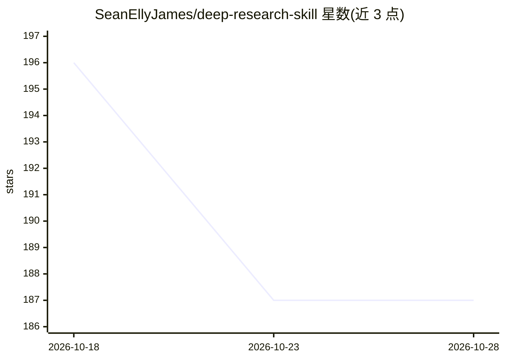

# SeanEllyJames/deep-research-skill

⭐ 187 · NOASSERTION · 推送 2026-08-18 · [GitHub](https://github.com/SeanEllyJames/deep-research-skill) · 个人维护 · 中文 README

**让 AI Agent 做带判断的深度调研的即插即用提示词 skill 文件**

一个 Markdown 格式的 skill 文件（中文主版 SKILL.md、英文版 SKILL.en.md），粘贴或放入 Agent 的 skills 目录即可使用。内容为四阶段调研工作流（元思考、一手源精读、对比反例、交叉验证）加上六条反模式「翻车目录」，每条配检测信号，用于约束 Agent 产出论证式判断而非主题清单。适配任何能读 skill 文件、能派 subagent 的 Agent（Claude Code、Cursor、Cline 等），搜索步骤依赖用户已有的搜索/抓取工具并可降级适配。部分内容脱胎自 grapeot/context-infrastructure（MIT）。

## 筛选速览

| 维度 | 判定 | 备注 |
|---|---|---|
| AI 角色 | `ai-knowledge` | 知识聚合/清单类 |
| 许可风险 | `permissive` | NOASSERTION |
| 部署形态 | `None` |  |
| 模型依赖 | — | README 未给出锁定关系 |
| 硬件要求 | — | 无带数字的原话,不猜 |
| 安装摩擦 | `low` | 无编译、无系统依赖或容器化 |
| 成熟度 | — | 结构信号不足 |

## 能力要点

- 四阶段工作流：元思考 / 一手源精读 / 对比反例 / 交叉验证
- 六条反模式及逐条检测信号（含子 agent 递归 fan-out 失控案例）
- 单文件即插即用，无需安装，提供中英双语版本
- 明确区分 Wide Research 与 Deep Research 两种调研模式

## 适用场景

- 让 Claude Code / Cursor / Cline 等 Agent 按论证式流程做深度调研
- 防止 Agent 产出主题分类式清单而缺少判断的报告
- 排查调研过程中子 agent 递归扩张等常见失败模式

## 场景标签

`提示工程` `科研工具` · 领域:Agent 开发

## 证据(README 行号)

> L11: 一个即插即用的 Markdown 文件　·　无需安装　·　粘进去就能用
> L79: 1.  把 SKILL.md 放进 Agent 的 skills 目录，或直接粘进系统提示词 / 项目指令
> L84: 任何能读 skill 文件、能派 subagent 的 Agent 都能用（Claude Code、Cursor、Cline 等）。搜索那一步默认你手上有一个搜索 / 抓取工具（比如 Tavily 这类搜索 MCP，或 Agent

## 星数曲线

2026-10-18 196 → 2026-10-28 187（-9）

---
*卡片 v1 · prompt 1.4 · 生成 2026-10-22 · 置信度 high · 依据 README sha `ebd47acf48c9` · [字段定义](../../DATASET.md)*
