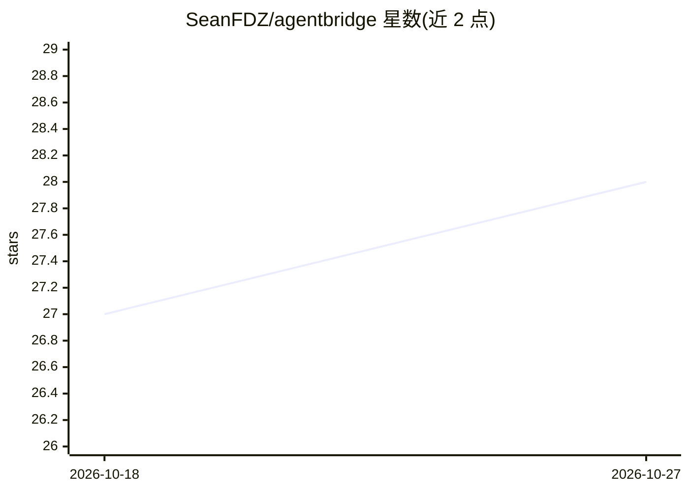

# SeanFDZ/agentbridge

⭐ 28 · C · GPL-3.0 · 推送 2026-04-20 · [GitHub](https://github.com/SeanFDZ/agentbridge) · [官网](https://apps.fallingdata.zone/agentbridge/) · 个人维护

**让 AI agent 通过共享文件夹协议控制 Classic Mac OS（7–9）**

运行在经典 Mac OS（System 7.0–9.2.2）上的原生应用，配合 Node.js/TypeScript 实现的 MCP 服务器，使 Claude 等 AI agent 能通过共享文件夹中的文本协议对 Mac 执行枚举窗口、点击、输入文本、读写剪贴板、启动/退出应用、发送 Apple Event、浏览文件等操作。传输层为 NAS/模拟器共享目录，无需 SSH 或系统修改。协议为行式键值文本（MacRoman 编码、32KB 上限、CR 行尾），68k 与 PowerPC 提供预编译二进制，源码不分发。

## 筛选速览

| 维度 | 判定 | 备注 |
|---|---|---|
| AI 角色 | `ai-ecosystem` | LLM/agent 周边工具 |
| 许可风险 | `viral` | GPL-3.0 |
| 部署形态 | `desktop` | 安装包/桌面程序 |
| 模型依赖 | — | README 未给出锁定关系 |
| 硬件要求 | — | 无带数字的原话,不猜 |
| 安装摩擦 | `low` | 无编译、无系统依赖或容器化 |
| 成熟度 | — | 结构信号不足 |

## 能力要点

- 共享文件夹作传输层，通过 inbox/outbox 文本消息轮询通信
- MCP 服务器暴露系统、窗口、菜单、鼠标键盘、剪贴板、应用与文件等工具
- 68k（System 7–8.1）实测，PowerPC（OS 8.5–9.2.2）可构建未实测
- 自定义行式键值文本协议，约 50 行 C 可解析、零动态内存分配

## 适用场景

- 让 Claude 等 AI agent 操作真机或模拟器中的经典 Mac OS
- 通过自然语言驱动老 Mac 上的应用、菜单与文件操作
- 多台 Classic Mac 组成 fleet 由同一 MCP 服务器管理

## 场景标签

`GUI 自动化` · 领域:效率与自动化

## 证据(README 行号)

> L9: Drop AgentBridge into a shared folder, launch it on your Mac, and an AI agent can list windows, open apps, type text
> L277: The MCP server exposes AgentBridge commands as tools for AI agents like Claude. It's a Node.js TypeScript server t
> L32: The MCP server exposes these tools to AI agents. If the fleet has only one target, the `target` parameter is option

## 星数曲线

2026-10-18 27 → 2026-10-27 28（+1）

---
*卡片 v1 · prompt 1.4 · 生成 2026-10-26 · 置信度 high · 依据 README sha `cd62cd98b1a2` · [字段定义](../../DATASET.md)*
