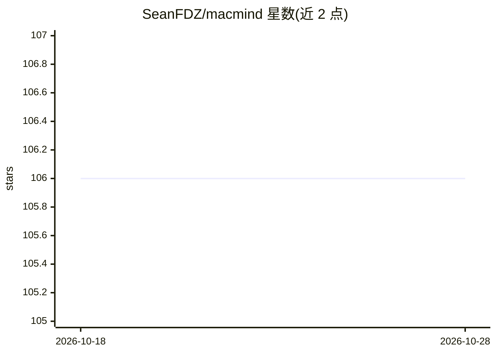

# SeanFDZ/macmind

⭐ 106 · Python · MIT · 推送 2026-08-26 · [GitHub](https://github.com/SeanFDZ/macmind) · 个人维护

**纯 HyperTalk 实现的单层 transformer，在经典 Macintosh 上训练**

1,216 参数的单层单头 transformer，全部用 1987 年的 HyperTalk 脚本语言编写，在 Macintosh SE/30（System 7.6.1、HyperCard 2.1）上训练。任务是从随机样本学习 FFT 的位反转置换，含 token 嵌入、位置编码、自注意力、交叉熵损失、完整反向传播与 SGD。以 5 张卡的 HyperCard 栈提供：训练、推理、注意力图可视化；训练后注意力呈现 FFT 蝶形路由。真机每步耗时数秒，收敛约需千步（数小时）。另附 Python/NumPy 参考实现用于验证。无前馈块与 layer norm。

## 筛选速览

| 维度 | 判定 | 备注 |
|---|---|---|
| AI 角色 | `ai-native` | 本体是模型或模型工具 |
| 许可风险 | `permissive` | MIT |
| 部署形态 | `library` | 以包/库形式分发 |
| 模型依赖 | — | README 未给出锁定关系 |
| 硬件要求 | — | 无带数字的原话,不猜 |
| 安装摩擦 | `low` | 无编译、无系统依赖或容器化 |
| 成熟度 | — | 结构信号不足 |

## 能力要点

- 1,216 参数 transformer 全部用 HyperTalk 实现，无编译代码与外部库
- 学习 FFT 位反转置换，注意力图独立呈现 Cooley-Tukey 蝶形结构
- 5 卡 HyperCard 栈：实时训练、推理测试、8x8 注意力可视化
- 权重以逗号分隔数字存于隐藏字段，保存栈即保存模型

## 适用场景

- 在教学/复古计算场景直观理解注意力与反向传播的数学过程
- 在真机或模拟器上运行并亲手训练一个可读的 transformer
- 用 Python 参考实现验证同一架构的收敛结果

## 场景标签

`教程课程` · 领域:学习与行业

## 证据(README 行号)

> L3: **A transformer neural network implemented entirely in HyperTalk, trained on a Macintosh SE/30.**
> L5: MacMind is a 1,216-parameter single-layer single-head transformer that learns the bit-reversal permutation, the open
> L119: MacMind was trained on a Macintosh SE/30 running System 7.6.1 and has also been tested through Basilisk II on Appl

## 星数曲线

2026-10-18 106 → 2026-10-28 106（+0）

---
*卡片 v1 · prompt 1.4 · 生成 2026-10-23 · 置信度 mid · 依据 README sha `4974bf0d20e0` · [字段定义](../../DATASET.md)*
