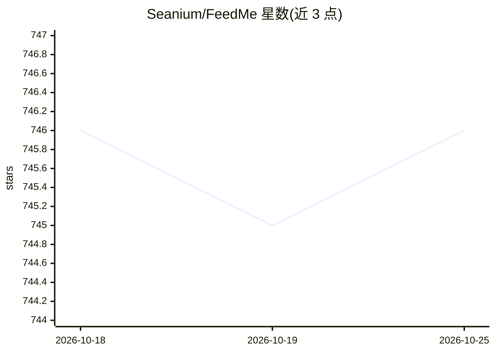

# Seanium/FeedMe

⭐ 746 · TypeScript · MIT · 推送 2026-10-24 · [GitHub](https://github.com/Seanium/FeedMe) · [官网](http://seanium.github.io/FeedMe/) · 个人维护 · 中文 README

**AI 自动摘要的轻量自托管 RSS 阅读器，静态页面多平台部署**

基于 TypeScript/React/Vite 的响应式静态 RSS 阅读器：抓取多源 RSS 内容，通过可配置的 LLM API 自动生成多语言文章摘要（可调提示词、temperature、maxTokens），GitHub Actions 或容器内 Cron 定时更新。提供四种部署方式：GitHub Pages、Vercel、阿里云 ESA Pages、Docker 本地部署；RSS 源、更新频率与 AI 配置均由用户在 YAML 配置文件中自定义。无强制登录与客户端下载，AI 摘要功能依赖外部 LLM 服务密钥。

## 筛选速览

| 维度 | 判定 | 备注 |
|---|---|---|
| AI 角色 | `ai-enhanced` | 去掉 AI 部分产品仍成立 |
| 许可风险 | `permissive` | MIT |
| 部署形态 | `self-host` | docker 或自建部署 |
| 模型依赖 | — | README 未给出锁定关系 |
| 硬件要求 | — | 无带数字的原话,不猜 |
| 安装摩擦 | `low` | 无编译、无系统依赖或容器化 |
| 成熟度 | — | 结构信号不足 |

## 能力要点

- LLM 自动生成多语言文章摘要，提示词与参数可配置
- GitHub Pages / Vercel / 阿里云 ESA Pages / Docker 四种部署方式
- GitHub Actions 或容器内 Cron 定时抓取 RSS 并重建
- RSS 源、分类与更新频率通过 YAML 配置自定义

## 适用场景

- 自建零成本 RSS 聚合阅读页面
- 定时获取带 AI 摘要的订阅内容更新
- 通过 Docker 在私有服务器上部署阅读器

## 场景标签

`网页抓取` · 领域:效率与自动化

## 证据(README 行号)

> L22: - 🤖 **效率至上**：AI 自动生成文章摘要，把握重点
> L30: - **聚合摘要**：一站式整合多源 RSS，通过 LLM 自动生成摘要

## 星数曲线

2026-10-18 746 → 2026-10-25 746（+0）

---
*卡片 v1 · prompt 1.4 · 生成 2026-10-18 · 置信度 mid · 依据 README sha `7221f55a298d` · [字段定义](../../DATASET.md)*
