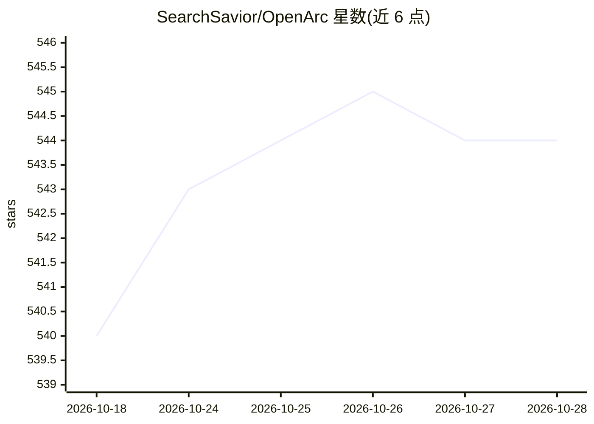

# SearchSavior/OpenArc

⭐ 544 · Python · Apache-2.0 · 推送 2026-10-13 · [GitHub](https://github.com/SearchSavior/OpenArc) · [官网](https://searchsavior.github.io/OpenArc/) · 组织维护

**面向 Intel 设备的推理引擎，经 OpenAI 兼容端点服务多种模型**

基于 OpenVINO/openvino-genai 的本地推理引擎，面向 Intel 硬件用户：在同一服务器上同时托管 LLM、VLM、Whisper、Kokoro-TTS、Qwen-TTS/ASR、Embedding 与 Reranker 模型，通过 OpenAI 兼容端点（/v1/chat/completions、/v1/audio/transcriptions 等）对外提供。支持多 GPU 流水并行、CPU offload、NPU 设备、投机解码、多模型并发加载与逐请求指标。README 标注项目处于活跃开发中，当前需安装 openvino-genai nightly wheel 才能运行最新模型。

## 筛选速览

| 维度 | 判定 | 备注 |
|---|---|---|
| AI 角色 | `ai-ecosystem` | LLM/agent 周边工具 |
| 许可风险 | `permissive` | Apache-2.0 |
| 部署形态 | `library` | 以包/库形式分发 |
| 模型依赖 | — | README 未给出锁定关系 |
| 硬件要求 | — | 无带数字的原话,不猜 |
| 安装摩擦 | `low` | 无编译、无系统依赖或容器化 |
| 成熟度 | `idea` | |

## 能力要点

- OpenAI 兼容端点覆盖 chat/completions/转写/TTS/嵌入/重排
- 同服务器同时托管语音、TTS 与 LLM
- 多 GPU 流水并行、CPU offload 与 NPU 设备支持
- 投机解码与多模型并发推理，逐请求输出 ttft/吞吐等指标

## 适用场景

- 在 Intel CPU/GPU/NPU 上本地部署并服务 LLM
- 用 OpenAI 兼容 API 统一接入语音转写与 TTS
- 同时加载多个模型做并发推理与基准测试

## 场景标签

`推理引擎` · 领域:训练与推理

## 证据(README 行号)

> L18: **OpenArc** is an inference engine for Intel devices.
> L20: Serve LLMs, VLMs, Whisper, Kokoro-TTS, Qwen-TTS, Qwen-ASR, Embedding and Reranker models over OpenAI compatible end
> L47:  - OpenAI compatible endpoints

## 星数曲线

2026-10-18 540 → 2026-10-28 544（+4）

---
*卡片 v1 · prompt 1.4 · 生成 2026-10-21 · 置信度 mid · 依据 README sha `c6b6d1054eb0` · [字段定义](../../DATASET.md)*
