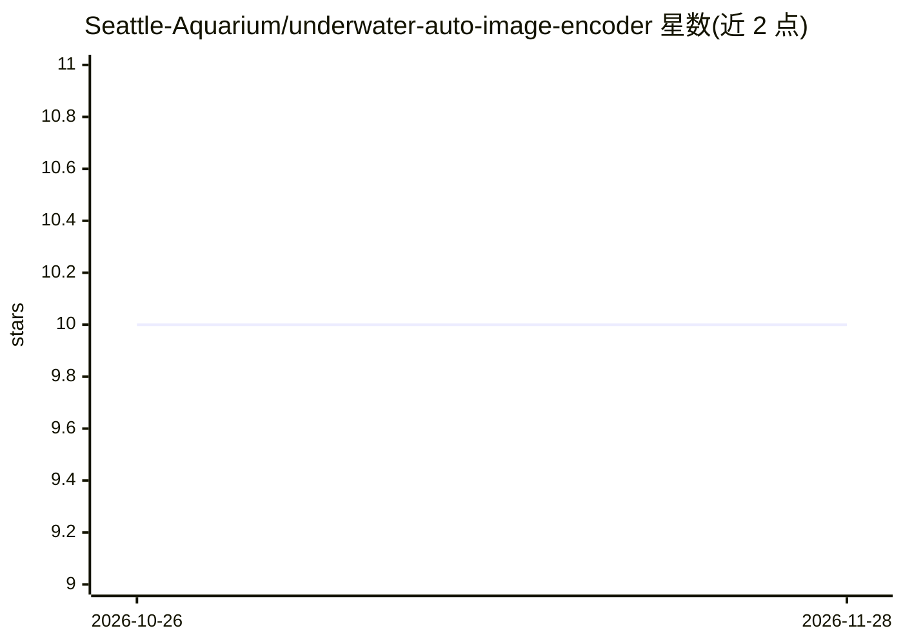

# Seattle-Aquarium/underwater-auto-image-encoder

⭐ 10 · Python · 推送 2026-07-02 · [GitHub](https://github.com/Seattle-Aquarium/underwater-auto-image-encoder) · 组织维护

**水下 ROV 图像增强 ML 管线，免手动修图**

面向海洋馆 ROV 调查拍摄的水下 GoPro 图像的自动化机器学习管线：将 RAW GPR 文件转换为增强图像，对标手动 Adobe Lightroom 修图效果。提供无需编程的 Windows/macOS/Linux 桌面 GUI 应用（下载应用与 .pth 模型即可批处理），也支持训练自定义模型与命令行推理；提供 4 种模型架构（unet、ushape_transformer、ss_uie、3d_lut）、多种损失函数与训练参数配置，预训练模型与数据集发布在 Hugging Face。ss_uie 架构需要 CUDA。

## 筛选速览

| 维度 | 判定 | 备注 |
|---|---|---|
| AI 角色 | `ai-native` | 本体是模型或模型工具 |
| 许可风险 | `none` | — |
| 部署形态 | `library` | 以包/库形式分发 |
| 模型依赖 | — | README 未给出锁定关系 |
| 硬件要求 | — | 无带数字的原话,不猜 |
| 安装摩擦 | `medium` | 含编译或系统依赖之一 |
| 成熟度 | — | 结构信号不足 |

## 能力要点

- 4 种模型架构可选（U-Net、U-shape Transformer、SS-UIE、3D LUT）
- 免编程桌面 GUI 应用，覆盖 Windows/macOS/Linux
- RAW GPR 文件预处理与批量图像增强
- 预训练模型与数据集发布于 Hugging Face

## 适用场景

- 批量增强 ROV 调查的水下 GoPro 照片
- 训练自定义水下图像增强模型
- 将图像增强集成进自动化工作流

## 场景标签

`图像视频处理` `模型训练` · 领域:感知与多模态

## 证据(README 行号)

> L3: This is an automated machine learning pipeline that replaces manual image editing for underwater GoPro images captur
> L10: **No programming required** - Desktop application available for Windows, macOS, and Linux.

## 星数曲线

2026-10-26 10 → 2026-11-28 10（+0）

---
*卡片 v1 · prompt 1.4 · 生成 2026-11-20 · 置信度 high · 依据 README sha `0a83371719b6` · [字段定义](../../DATASET.md)*
