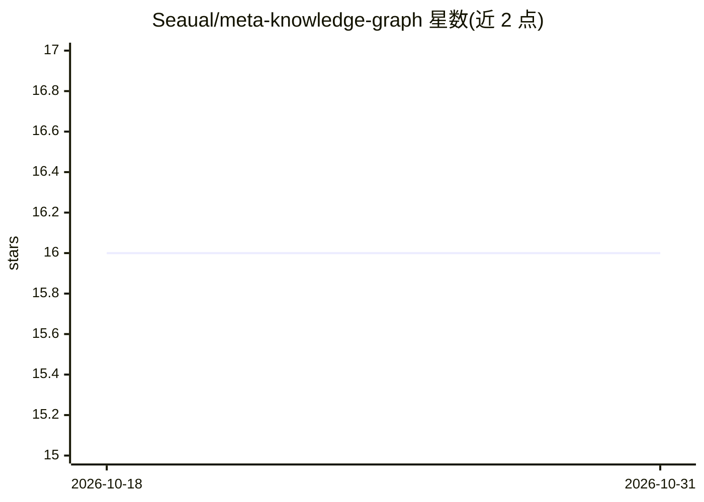

# Seaual/meta-knowledge-graph

⭐ 16 · Python · MIT · 推送 2026-06-24 · [GitHub](https://github.com/Seaual/meta-knowledge-graph) · 个人维护 · 中文 README

**面向科研者的 LLM 学术知识图谱引擎：从论文 PDF 抽取概念并交互可视化**

自托管的学术知识图谱构建工具：上传研究 PDF 后自动解析元数据并用 Semantic Scholar 增强，两阶段 LLM 抽取生成中英双语概念层级（field 到 technique 等 8 类），合并为力导向交互图谱；提供 4 种研究点发现方法、多 Agent 系统（LangGraph 构建，含论文问答、引文分析、深度研究）以及 HTML/Obsidian Canvas/Markdown 导出。支持 Claude/Gemini/OpenAI/Qwen/DeepSeek 等 8 家 LLM 提供商，API Key 本地存储。以 Docker 或源码（FastAPI 后端 + React 前端）方式部署。

## 筛选速览

| 维度 | 判定 | 备注 |
|---|---|---|
| AI 角色 | `ai-native` | 本体是模型或模型工具 |
| 许可风险 | `permissive` | MIT |
| 部署形态 | `self-host` | docker 或自建部署 |
| 模型依赖 | locked-api |  |
| 硬件要求 | — | 无带数字的原话,不猜 |
| 安装摩擦 | `low` | 无编译、无系统依赖或容器化 |
| 成熟度 | — | 结构信号不足 |

## 能力要点

- 两阶段 LLM 概念抽取，8 类层级概念（field→technique）中英双语
- 基于 LangGraph 的多 Agent 系统：论文问答、引文分析、深度研究
- 4 种研究点发现方法（Gap Filling/Leaf Extension/Bottleneck/Transfer）
- 导出 HTML 交互图谱、Obsidian Canvas 与 Markdown 双链格式

## 适用场景

- 把成批论文 PDF 整理成可交互浏览的知识图谱
- 在概念图谱上发现潜在研究方向并查看分析依据
- 通过对话 Agent 查询自己论文库的内容与引用关系

## 场景标签

`知识图谱` `科研工具` `文档问答` · 领域:知识与检索

## 证据(README 行号)

> L16:  Upload research PDFs → LLM extracts hierarchical concepts →
> L31: |🧠 **Two-Stage Concept Extraction**|Stage 1: Paper understanding → Stage 2: Hierarchical concept extraction with 8 
> L126: MKG includes a multi-agent system built on LangGraph for intelligent research assistance:

## 星数曲线

2026-10-18 16 → 2026-10-31 16（+0）

---
*卡片 v1 · prompt 1.4 · 生成 2026-10-30 · 置信度 high · 依据 README sha `f5255417638d` · [字段定义](../../DATASET.md)*
