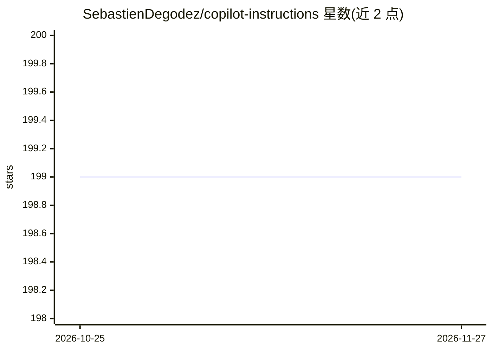

# SebastienDegodez/copilot-instructions

⭐ 199 · TypeScript · Apache-2.0 · 推送 2026-11-06 · [GitHub](https://github.com/SebastienDegodez/copilot-instructions) · [官网](https://sebastiendegodez.github.io/copilot-instructions/) · 个人维护

**为 GitHub Copilot 等 AI 编码工具提供的编码规范与提示词指令库**

按 awesome-copilot 结构组织的指令/技能/Agent/插件集合：instructions 定义 DDD、CQRS、测试、提交规范等编码标准，prompts 提供任务模板，chatmodes 定义 AI 会话行为，plugins 打包可安装的技能与 LSP 集成。包含 SKRAFT 五阶段确定性 SDLC 流水线插件与 Microsoft MCP server 集成，可经 Copilot CLI、Claude Code 插件市场或 APM 安装。内容以 .NET 后端（C# Clean Architecture）为主，插件 README 使用法语。

## 筛选速览

| 维度 | 判定 | 备注 |
|---|---|---|
| AI 角色 | `ai-knowledge` | 知识聚合/清单类 |
| 许可风险 | `permissive` | Apache-2.0 |
| 部署形态 | `self-host` | docker 或自建部署 |
| 模型依赖 | — | README 未给出锁定关系 |
| 硬件要求 | — | 无带数字的原话,不猜 |
| 安装摩擦 | `low` | 无编译、无系统依赖或容器化 |
| 成熟度 | — | 结构信号不足 |

## 能力要点

- instructions/prompts/chatmodes/skills/plugins 五类内容组织
- LSP 插件覆盖 Python/Java/C#/TypeScript 等 10 种语言服务器
- SKRAFT 插件：5 阶段 SDLC 流水线与 G1–G8 机械护栏
- 支持 Copilot CLI、Claude Code、Cursor 三种载体

## 适用场景

- 为 .NET 团队建立统一的 AI 辅助编码规范
- 给 Copilot/Claude Code 安装领域技能与 LSP 代码智能插件
- 用 APM 在多个项目中复用同一套 AI 指令集合

## 场景标签

`提示工程` · 领域:Agent 开发

## 证据(README 行号)

> L4: This project provides a set of best practices, coding rules, and prompt instructions to guide AI-assisted developmen
> L51: This repository follows the awesome-copilot structure and conventions for organizing instructions, skills, agents, 
> L139: A **collection** is a YAML file (in `collections/`) that groups related instructions, prompts, and chatmodes into 

## 星数曲线

2026-10-25 199 → 2026-11-27 199（+0）

---
*卡片 v1 · prompt 1.4 · 生成 2026-11-25 · 置信度 mid · 依据 README sha `edaf4b39b740` · [字段定义](../../DATASET.md)*
