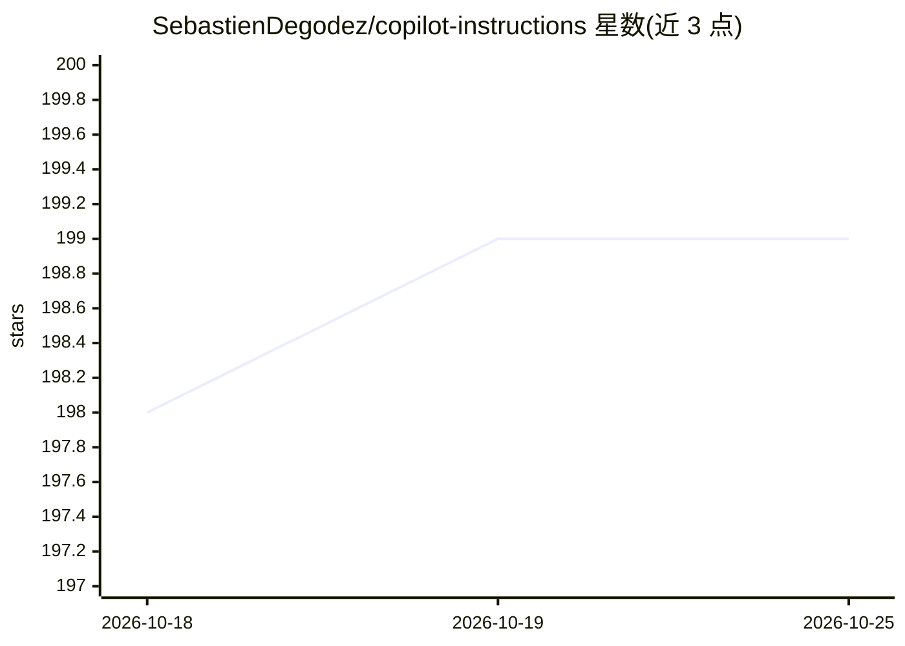

# SebastienDegodez/copilot-instructions

⭐ 199 · TypeScript · Apache-2.0 · 推送 2026-10-06 · [GitHub](https://github.com/SebastienDegodez/copilot-instructions) · [官网](https://sebastiendegodez.github.io/copilot-instructions/) · 个人维护

**面向 GitHub Copilot 等 AI 助手的编码规则与技能文件合集**

为 AI 辅助开发提供的一组指令、技能、agent 人设、插件与 chatmode 配置文件：内容覆盖 DDD、Clean Architecture、CQRS、TDD、测试策略、提交规范等 .NET 后端规范，AI 生成代码前须先澄清问题并展示置信度。包含 SKRAFT 确定性 SDLC 流水线插件（五阶段、专项 agent 与对抗式评审、G1–G8 守卫），兼容 Claude Code、GitHub Copilot 与 Cursor；collections 以 YAML 组织，可经 APM 安装管理。面向希望统一团队与 AI 工具编码规范的 .NET 开发者。

## 筛选速览

| 维度 | 判定 | 备注 |
|---|---|---|
| AI 角色 | `ai-knowledge` | 知识聚合/清单类 |
| 许可风险 | `permissive` | Apache-2.0 |
| 部署形态 | `None` |  |
| 模型依赖 | — | README 未给出锁定关系 |
| 硬件要求 | — | 无带数字的原话,不猜 |
| 安装摩擦 | `medium` | 含编译或系统依赖之一 |
| 成熟度 | — | 结构信号不足 |

## 能力要点

- DDD/Clean Architecture/CQRS/TDD 等 .NET 编码规则指令文件
- SKRAFT 插件：五阶段 SDLC 流水线（DISCOVER→DELIVER）与 G1–G8 机械守卫
- skills/agents/plugins/chatmodes/collections 五类组织结构，可经 APM 安装
- 兼容 Claude Code、GitHub Copilot、Cursor 三种 harness

## 适用场景

- 为团队和 Copilot 配置统一的编码与架构规范
- 让 AI 在生成代码前先澄清需求并展示置信度
- 通过 SKRAFT 插件把编码助手约束为分阶段、可验证的 SDLC 流水线

## 场景标签

`提示工程` · 领域:Agent 开发

## 证据(README 行号)

> L4: This project provides a set of best practices, coding rules, and prompt instructions to guide AI-assisted developmen
> L9: - Provides prompt and instruction files for consistent, high-quality code generation.
> L51: This repository follows the awesome-copilot structure and conventions for organizing instructions, skills, agents, 

## 星数曲线

2026-10-18 198 → 2026-10-25 199（+1）

---
*卡片 v1 · prompt 1.4 · 生成 2026-10-22 · 置信度 high · 依据 README sha `6e59ae741a56` · [字段定义](../../DATASET.md)*
