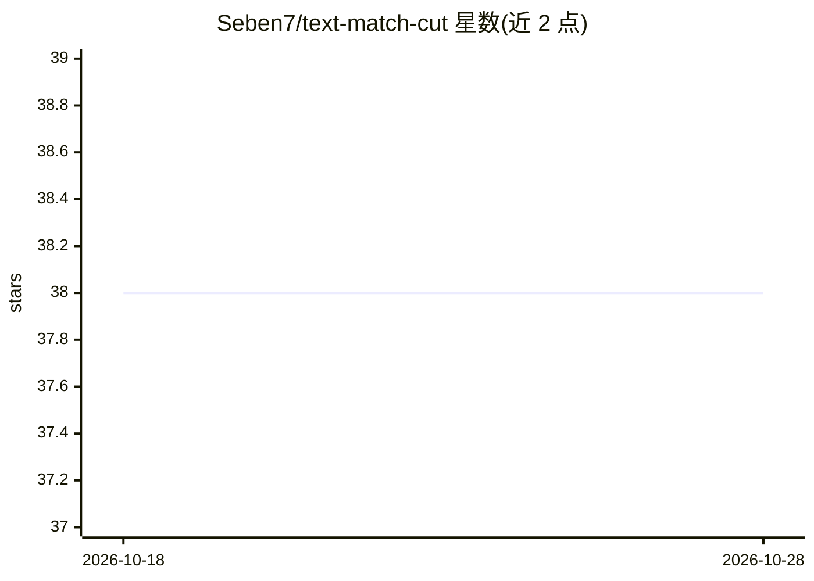

# Seben7/text-match-cut

⭐ 38 · Python · MIT · 推送 2026-02-19 · [GitHub](https://github.com/Seben7/text-match-cut) · 个人维护

**面向创作者的网页应用：生成文字与画面匹配的转场视频**

在浏览器中运行的文字匹配剪辑（text match cut）视频生成应用：用户上传视频、输入文本、选择效果后，应用分析文本关键短语、选取视频中对应帧并生成平滑转场。定位面向创作者与营销人员，网页端使用无需下载安装本体，通过 Releases 下载发布包运行。技术栈包含 HTML/CSS/JavaScript 与 FFmpeg，README 提及 API 集成与 After Effects 相关主题，版本路线图中规划了 AI 驱动的文本与效果建议。

## 筛选速览

| 维度 | 判定 | 备注 |
|---|---|---|
| AI 角色 | `ai-native` | 本体是模型或模型工具 |
| 许可风险 | `permissive` | MIT |
| 部署形态 | `None` |  |
| 模型依赖 | — | README 未给出锁定关系 |
| 硬件要求 | — | 无带数字的原话,不猜 |
| 安装摩擦 | `medium` | 含编译或系统依赖之一 |
| 成熟度 | — | 结构信号不足 |

## 能力要点

- 文本关键短语分析与视频帧匹配生成转场
- 网页端操作，浏览器内上传视频、输入文本、选择效果并生成
- 提供 API 用于项目集成
- 路线图规划 AI 驱动的文本与效果建议（Version 2.0）

## 适用场景

- 为短视频制作文字与画面匹配的转场效果
- 营销内容中快速生成带文字匹配剪辑的视频
- 通过 API 将文字匹配剪辑能力接入自己的项目

## 场景标签

`视频生成` · 领域:内容生成

## 证据(README 行号)

> L5: Welcome to the **Text Match Cut** repository! This web application allows users to generate engaging video content u
> L9: - **Text Match Cut Generation**: Automatically create stunning video transitions that match text elements.
> L25: 5. **Generate Video**: Click on the generate button and watch your video transform!

## 星数曲线

2026-10-18 38 → 2026-10-28 38（+0）

---
*卡片 v1 · prompt 1.4 · 生成 2026-10-25 · 置信度 mid · 依据 README sha `1404efaf7d7d` · [字段定义](../../DATASET.md)*
