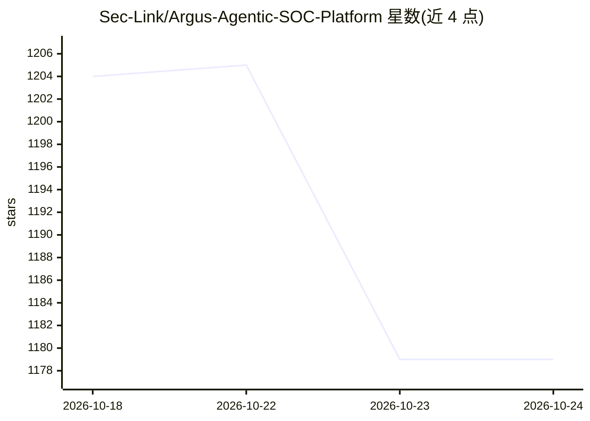

# Sec-Link/Argus-Agentic-SOC-Platform

⭐ 1,179 · Python · Apache-2.0 · 推送 2026-10-24 · [GitHub](https://github.com/Sec-Link/Argus-Agentic-SOC-Platform) · [官网](https://siem.seclink.info) · 组织维护 · 中文 README

**开源 AI 原生 Agentic SOC 平台，覆盖告警、工单、CMDB 与自动化**

面向安全运营团队的开源 SOC 平台：整合告警接入与检索、工单管理、CMDB 资产管理、仪表盘、关联规则、工作流编排等核心 SOC 对象，并内置面向安全的 AI 助手（对话界面、MCP 风格工具注册表与 JSON-RPC 连接器、工单上下文查询、相似案例检索、可观察项抽取）。架构松耦合、API 优先，可整体部署或集成进既有 SOC 生态。技术栈为 Next.js 15 前端 + Django/DRF 后端 + PostgreSQL（可选 Elasticsearch），提供 Docker Compose 与 Kubernetes 部署清单。

## 筛选速览

| 维度 | 判定 | 备注 |
|---|---|---|
| AI 角色 | `ai-enhanced` | 去掉 AI 部分产品仍成立 |
| 许可风险 | `permissive` | Apache-2.0 |
| 部署形态 | `self-host` | docker 或自建部署 |
| 模型依赖 | — | README 未给出锁定关系 |
| 硬件要求 | — | 无带数字的原话,不猜 |
| 安装摩擦 | `low` | 无编译、无系统依赖或容器化 |
| 成熟度 | — | 结构信号不足 |

## 能力要点

- 统一 SOC 能力：告警、工单、CMDB、仪表盘、关联规则、工作流编排
- 内置 AI 助手：MCP 风格工具注册表与 JSON-RPC 连接器
- 开箱即用检测用例与 Sigma 规则（一次编写、随处运行）
- 提供 docker-compose（dev/prod）与 K8s 部署清单

## 适用场景

- 作为完整 SOC 平台部署，统一管理告警与工单
- 把平台集成进既有安全运营生态（API 优先架构）
- 通过 AI 助手做工单上下文查询与相似案例检索
- 用 Detection-as-code 与 Sigma 规则管理检测逻辑

## 场景标签

`网络安全` `工作流自动化` · 领域:效率与自动化

## 证据(README 行号)

> L22: - ✅AI-powered Investigation
> L45: - **AI Assistant**: security-focused intelligent analysis and MCP tool integration
> L67: ### AI Features

## 星数曲线

2026-10-18 1,204 → 2026-10-24 1,179（-25）

---
*卡片 v1 · prompt 1.4 · 生成 2026-10-21 · 置信度 mid · 依据 README sha `7a40178aa4a1` · [字段定义](../../DATASET.md)*
