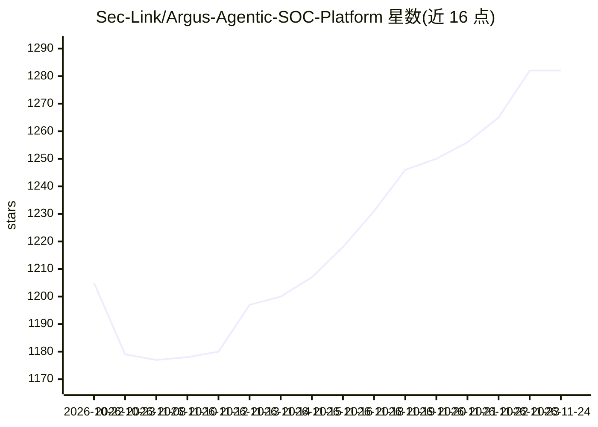

# Sec-Link/Argus-Agentic-SOC-Platform

⭐ 1,301 · Python · Apache-2.0 · 推送 2026-11-23 · [GitHub](https://github.com/Sec-Link/Argus-Agentic-SOC-Platform) · [官网](https://siem.seclink.info) · 组织维护 · 中文 README

**开源 AI 原生 Agentic SOC 安全运营平台**

面向安全运营中心场景的开源平台，可整体部署为完整 SOC 平台，也可通过松耦合 API-first 架构接入既有安全生态。功能覆盖告警接入与管理、工单生命周期、CMDB 资产上下文、关联检测规则（Sigma）、工作流自动化编排，以及内置 AI 助手（对话式分析、MCP 工具注册与 JSON-RPC 连接、工单上下文查询与相似案例检索）。前端 Next.js，后端 Django + DRF，PostgreSQL 为主存储，支持 Docker Compose 与 Kubernetes 部署。

## 筛选速览

| 维度 | 判定 | 备注 |
|---|---|---|
| AI 角色 | `ai-enhanced` | 去掉 AI 部分产品仍成立 |
| 许可风险 | `permissive` | Apache-2.0 |
| 部署形态 | `self-host` | docker 或自建部署 |
| 模型依赖 | — | README 未给出锁定关系 |
| 硬件要求 | — | 无带数字的原话,不猜 |
| 安装摩擦 | `low` | 无编译、无系统依赖或容器化 |
| 成熟度 | — | 结构信号不足 |

## 能力要点

- 内置 AI 助手：MCP 风格工具注册与 JSON-RPC 连接、工单上下文查询与相似案例检索
- 松耦合 API-first 架构，可扩展并接入既有 SOC 生态
- Sigma 规则检测即代码、规则版本化与关联分析
- 工作流编排、定时执行与审计日志

## 适用场景

- 集中管理告警、工单与资产上下文的安全运营
- 将告警处置流程编排为自动化工作流
- 通过 AI 助手在工单上下文中做调查分析
- 编写 Sigma 检测规则并统一运行

## 场景标签

`工作流自动化` `AI 助手` `网络安全` · 领域:效率与自动化

## 证据(README 行号)

> L17: **Argus** is an open-source **AI-native Agentic SOC platform** designed for modern security operations.
> L45: - **AI Assistant**: security-focused intelligent analysis and MCP tool integration
> L28: At the same time, Argus is built with a **loosely coupled and API-first architecture**, allowing organizations to:

## 星数曲线

2026-10-22 1,205 → 2026-11-24 1,282（+77）

---
*卡片 v1 · prompt 1.4 · 生成 2026-11-23 · 置信度 high · 依据 README sha `b2468c41e382` · [字段定义](../../DATASET.md)*
