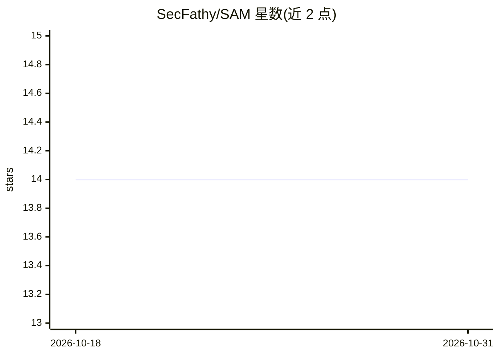

# SecFathy/SAM

⭐ 14 · Python · MIT · 推送 2026-03-16 · [GitHub](https://github.com/SecFathy/SAM) · [官网](https://pypi.org/project/sam-agent/) · 个人维护

**开源 CLI 编程 agent：连接自托管/开源 LLM 编辑代码**

终端交互式 AI 编程 agent，通过 OpenAI 兼容 API 接入 vLLM、Ollama、LM Studio 或远程端点运行的模型。提供 ReAct 循环、10+ 内置工具（文件读写、shell 执行、grep、git 状态/diff 等）、4 层模糊编辑、Tree-sitter 仓库映射与 PageRank 排序、计划模式（只读探索后产出结构化方案）、双模型规划/执行工作流与会话保存。以 Python 包发布于 PyPI，支持 pip 安装与源码安装，配置经 config.yaml 与 SAM_ 前缀环境变量加载。本地运行时代码不出机器。

## 筛选速览

| 维度 | 判定 | 备注 |
|---|---|---|
| AI 角色 | `ai-ecosystem` | LLM/agent 周边工具 |
| 许可风险 | `permissive` | MIT |
| 部署形态 | `library` | 以包/库形式分发 |
| 模型依赖 | local-ok | 支持本地模型 |
| 硬件要求 | — | 无带数字的原话,不猜 |
| 安装摩擦 | `low` | 无编译、无系统依赖或容器化 |
| 成熟度 | — | 结构信号不足 |

## 能力要点

- 通过 OpenAI 兼容 API 接入任意模型（vLLM/Ollama/LM Studio）
- ReAct 循环 + 10+ 内置工具（文件编辑、shell、grep、git 等）
- 计划模式：只读探索代码库后产出待审批的结构化方案
- Tree-sitter 仓库映射与 75% 上下文用量时自动历史摘要

## 适用场景

- 在本地或自托管模型上做终端内的代码修改与验证
- 先审阅计划再执行的多步代码改动
- 用大模型规划、小模型执行的双模型分工工作流

## 场景标签

`编码 Agent` · 领域:编码与开发

## 证据(README 行号)

> L20: SAM is a terminal-based AI coding agent that connects to **any OpenAI-compatible API** — vLLM, Ollama, LM Studio, o
> L6:  An open-source CLI coding agent for your own LLMs.

## 星数曲线

2026-10-18 14 → 2026-10-31 14（+0）

---
*卡片 v1 · prompt 1.4 · 生成 2026-10-31 · 置信度 high · 依据 README sha `8648e94a087e` · [字段定义](../../DATASET.md)*
