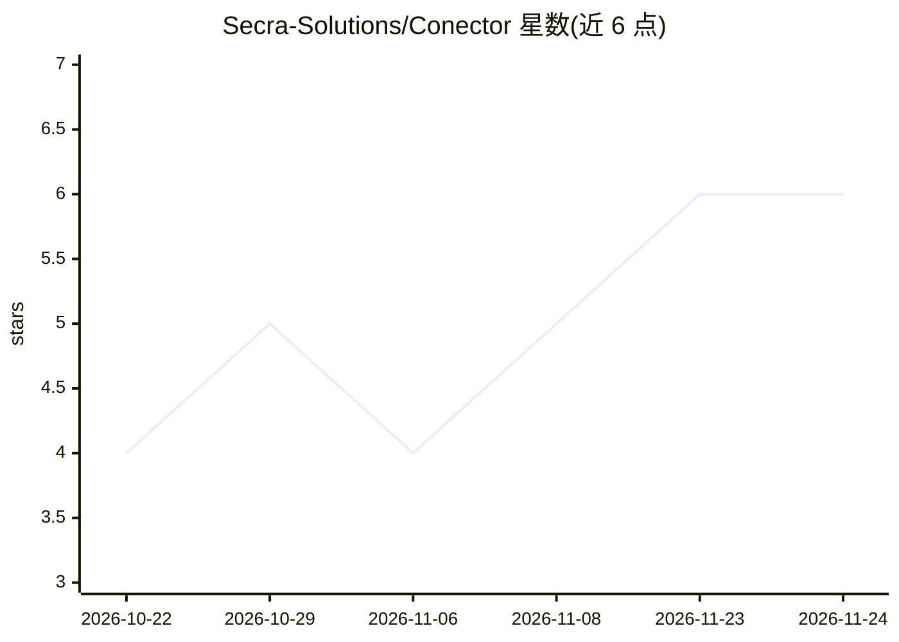

# Secra-Solutions/Conector

⭐ 6 · JavaScript · MIT · 推送 2026-10-24 · [GitHub](https://github.com/Secra-Solutions/Conector) · [官网](https://secra.es) · 组织维护

**自托管 MCP 网关：一次接入 1,178 个应用供 47 个 AI agent 调用**

以 MCP（Streamable HTTP）服务器形式运行的网关：用户在网页面板中通过 OAuth、API key 或账号密码连接应用（107 个一键连接），每个应用生成经认证的请求工具共 1,416 个；各 agent 通过访问令牌接入同一工具集，面板可为每个 agent 生成配置命令或写入其配置文件。凭证以 AES-256-GCM 加密存储于自有服务器，记录审计日志，支持管理员/成员角色与共享连接。需 Node.js 22+ 或 Docker 运行。

## 筛选速览

| 维度 | 判定 | 备注 |
|---|---|---|
| AI 角色 | `ai-ecosystem` | LLM/agent 周边工具 |
| 许可风险 | `permissive` | MIT |
| 部署形态 | `self-host` | docker 或自建部署 |
| 模型依赖 | — | README 未给出锁定关系 |
| 硬件要求 | — | 无带数字的原话,不猜 |
| 安装摩擦 | `low` | 无编译、无系统依赖或容器化 |
| 成熟度 | — | 结构信号不足 |

## 能力要点

- 1,178 个应用、1,416 个 MCP 工具，一次连接供多个 agent 共用
- 面板为 47 个 agent 自动生成配置或执行 conector install 写入
- 凭证 AES-256-GCM 加密、令牌仅存 SHA-256 哈希、全量审计日志
- 提供 REST API 与 stdio 桥接（conector stdio）两种接入方式

## 适用场景

- 自托管场景下集中管理各 AI agent 的应用凭证与工具
- 团队按成员/共享连接分配应用访问并限制每个 token 可用应用
- 为本地 CLI agent 与云端 agent 提供统一的 MCP 工具端点

## 场景标签

 · 领域:LLM 基础设施/MCP 工具网关

## 证据(README 行号)

> L3:  Connect 1,178 apps once and use them from Claude, Codex, Cursor, Gemini CLI, GitHub Copilot and 42 more AI agents.
> L32: 3. **Every agent gets tools for every app you connected**, over the Model Context Protocol.
> L119: Each agent authenticates with its own access token (`cnr_…`) and talks to `http://<server>/mcp` over Streamable HT

## 星数曲线

2026-10-22 4 → 2026-11-24 6（+2）

---
*卡片 v1 · prompt 1.4 · 生成 2026-11-21 · 置信度 high · 依据 README sha `620d04bc0edd` · [字段定义](../../DATASET.md)*
