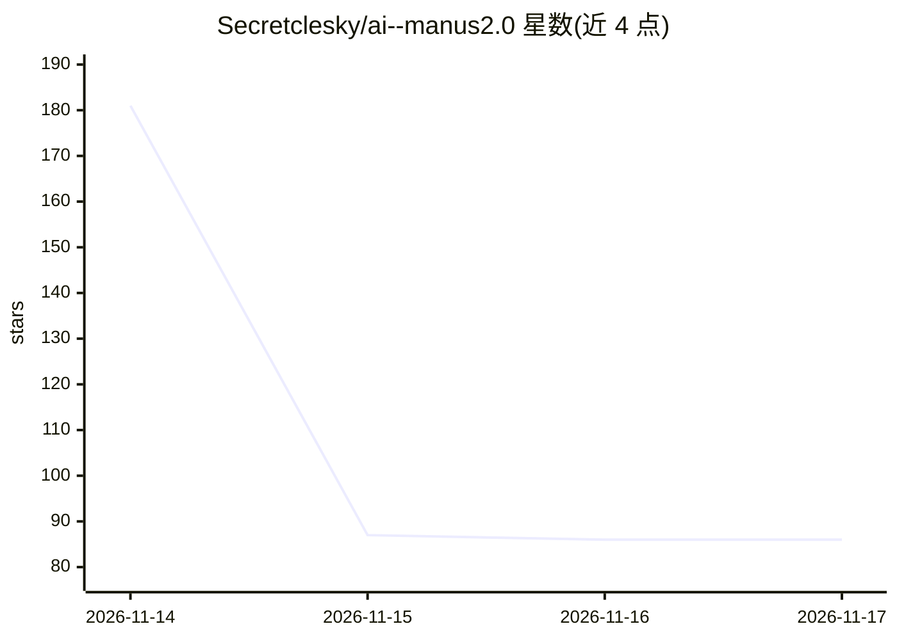

# Secretclesky/ai--manus2.0

⭐ 86 · Apache-2.0 · 推送 2026-11-15 · [GitHub](https://github.com/Secretclesky/ai--manus2.0) · 个人维护

**自主执行代码与控制浏览器的通用 AI Agent 桌面助手**

Manus 是一个自主 AI agent，用户描述任务后由 agent 自主规划步骤：编写并执行脚本、控制浏览器（导航网页、填表、收集信息）、执行多步骤任务，面向学习、家庭与轻量办公场景。README 以功能介绍与使用流程为主，说明配置、测试、定制触发行为等步骤，并列出最低 4GB 内存、双核 CPU 的兼容性要求；未提供具体安装命令、代码示例或 API 接入说明，仓库描述提及沙箱环境与多模型（OpenAI/Anthropic/Gemini），但 README 正文未展开。

## 筛选速览

| 维度 | 判定 | 备注 |
|---|---|---|
| AI 角色 | `ai-native` | 本体是模型或模型工具 |
| 许可风险 | `permissive` | Apache-2.0 |
| 部署形态 | `None` |  |
| 模型依赖 | — | README 未给出锁定关系 |
| 硬件要求 | — | 无带数字的原话,不猜 |
| 安装摩擦 | `low` | 无编译、无系统依赖或容器化 |
| 成熟度 | — | 结构信号不足 |

## 能力要点

- 自主编写并执行代码完成任务
- 浏览器控制：导航、填表、收集信息
- 脚本与浏览器动作可在同一流程内衔接
- 面向学习/家庭/轻量办公的小规模场景

## 适用场景

- 让学生收集资料、运行小脚本并整理笔记
- 自动检查网页更新或填写重复表单
- 开发时快速运行小实验而无需搭建完整环境

## 场景标签

`AI 助手` `浏览器自动化` `编码 Agent` · 领域:效率与自动化

## 证据(README 行号)

> L10: - **Autonomous Code Execution:** Manus AI agent runs code on its own to complete tasks, so you can focus on decisio
> L18: Manus is an autonomous AI agent designed to run code and control a browser on your behalf. Instead of acting like a

## 星数曲线

2026-11-14 181 → 2026-11-17 86（-95）

---
*卡片 v1 · prompt 1.4 · 生成 2026-11-17 · 置信度 mid · 依据 README sha `637da4fbcded` · [字段定义](../../DATASET.md)*
