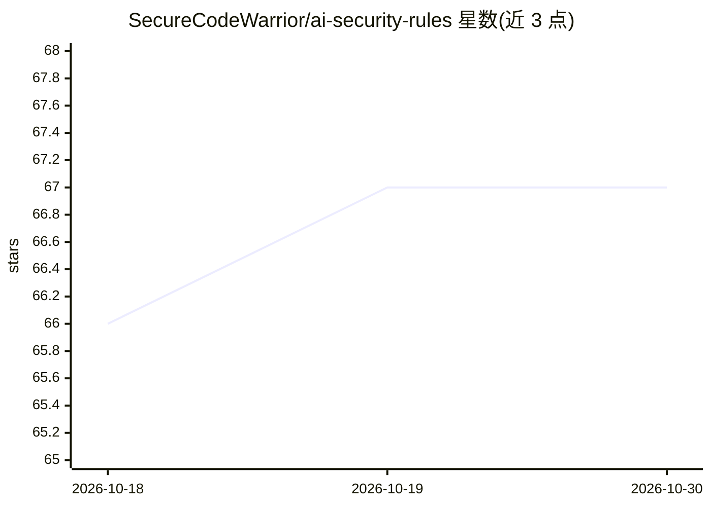

# SecureCodeWarrior/ai-security-rules

⭐ 67 · 推送 2026-02-06 · [GitHub](https://github.com/SecureCodeWarrior/ai-security-rules) · [官网](https://securecodewarrior.com) · 组织维护

**面向 AI 编码助手的安全规则文件集，引导安全编码**

由 SecureCodeWarrior 维护的安全规则文件仓库，版本 1.2.0：提供后端、前端、移动端及 Python 语言专属的安全实践规则文件，可复制到 GitHub Copilot、Cursor、Windsurf、Cline、Roo、Aider 等 AI 编码助手的项目目录中，使工具在编码时应用安全指令。README 声明这些规则不能替代安全开发培训或人工代码审查，且禁止未经许可用于商业用途。

## 筛选速览

| 维度 | 判定 | 备注 |
|---|---|---|
| AI 角色 | `ai-knowledge` | 知识聚合/清单类 |
| 许可风险 | `none` | — |
| 部署形态 | `None` |  |
| 模型依赖 | — | README 未给出锁定关系 |
| 硬件要求 | — | 无带数字的原话,不猜 |
| 安装摩擦 | `low` | 无编译、无系统依赖或容器化 |
| 成熟度 | — | 结构信号不足 |

## 能力要点

- 平台级规则：backend/frontend/mobile 三类安全实践
- 语言级规则：Python 反序列化、密码学与安全编码模式
- 适配 6 种 AI 编码工具的配置路径说明
- 可编辑扩展以匹配组织自身的安全与开发政策

## 适用场景

- 在 Cursor/Copilot 等工具中注入安全编码规则以减少不安全代码
- 在团队范围内统一 AI 助手的编码标准
- 按语言或平台挑选对应的安全实践规则文件

## 场景标签

`网络安全` `提示工程` · 领域:Agent 开发

## 证据(README 行号)

> L8: This repository contains security rule files designed to be used with AI-assisted developer tools such as GitHub Cop
> L10: Each rule file defines security best practices that guide how AI tools interact with your codebase.

## 星数曲线

2026-10-18 66 → 2026-10-30 67（+1）

---
*卡片 v1 · prompt 1.4 · 生成 2026-10-24 · 置信度 high · 依据 README sha `9585ab56ef29` · [字段定义](../../DATASET.md)*
