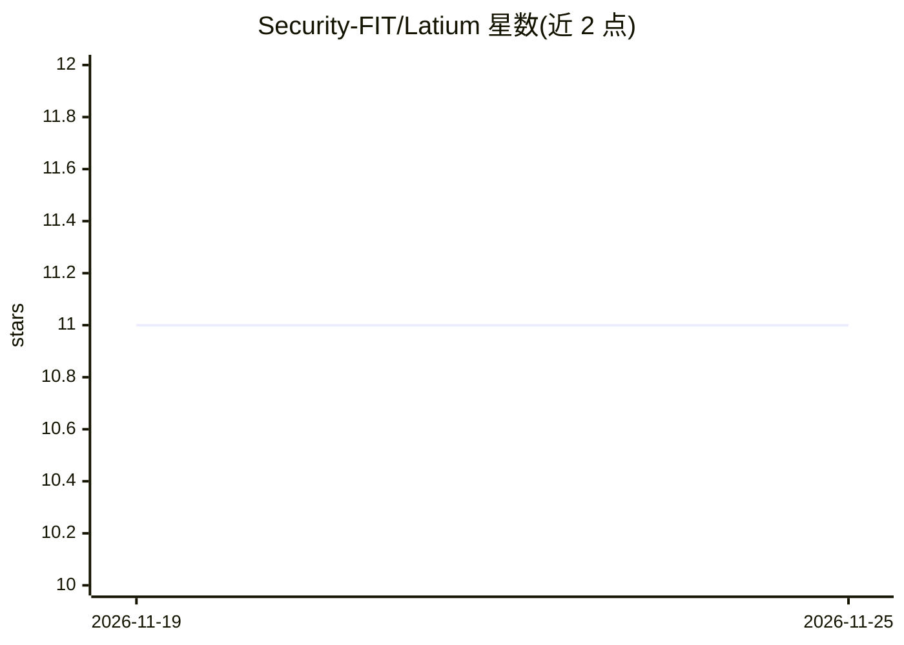

# Security-FIT/Latium

⭐ 11 · Python · MIT · 推送 2026-11-04 · [GitHub](https://github.com/Security-FIT/Latium) · 组织维护

**面向安全研究的 ROME 模型编辑复现与评测框架**

由 Security@FIT 与 Red Hat Research 合作的网络安全研究框架，用于重实现并评测 ROME（Rank-One Model Editing）。提供结构化编辑检测、因果追踪、产物化分析（manifest 记录配置与内容哈希）与图渲染；Hydra 配置驱动，入口为 python3 -m src。模型配置默认使用 CUDA，可选用 W&B 追踪与 MetaCentrum/PBS 远程集群提交。运行前需为模型计算二阶矩统计。

## 筛选速览

| 维度 | 判定 | 备注 |
|---|---|---|
| AI 角色 | `ai-ecosystem` | LLM/agent 周边工具 |
| 许可风险 | `permissive` | MIT |
| 部署形态 | `library` | 以包/库形式分发 |
| 模型依赖 | — | README 未给出锁定关系 |
| 硬件要求 | — | 无带数字的原话,不猜 |
| 安装摩擦 | `medium` | 含编译或系统依赖之一 |
| 成熟度 | — | 结构信号不足 |

## 能力要点

- ROME 单次编辑、基准评测与结构性运行的完整工作流
- 因果追踪与修正/替代追踪命令
- manifest 管理产物：记录哈希与依赖，重跑跳过未变项
- W&B 追踪与远程 GPU 协方差计算脚本

## 适用场景

- 评测各开源 LLM 上 ROME 编辑的成功率与层间信号
- 对模型编辑做因果追踪分析
- 生成论文级报告与逐层信号图
- 在远程集群批量提交编辑实验

## 场景标签

`模型评测` `网络安全` · 领域:评测与运维

## 证据(README 行号)

> L3: Latium is an open-source research framework for re-implementing and evaluating
> L7: The project is developed for cybersecurity research by the Security@FIT group in
> L30: Model configs default to CUDA. Model downloads are cached under `../models`,

## 星数曲线

2026-11-19 11 → 2026-11-25 11（+0）

---
*卡片 v1 · prompt 1.4 · 生成 2026-11-19 · 置信度 high · 依据 README sha `d9a79daeeaf5` · [字段定义](../../DATASET.md)*
