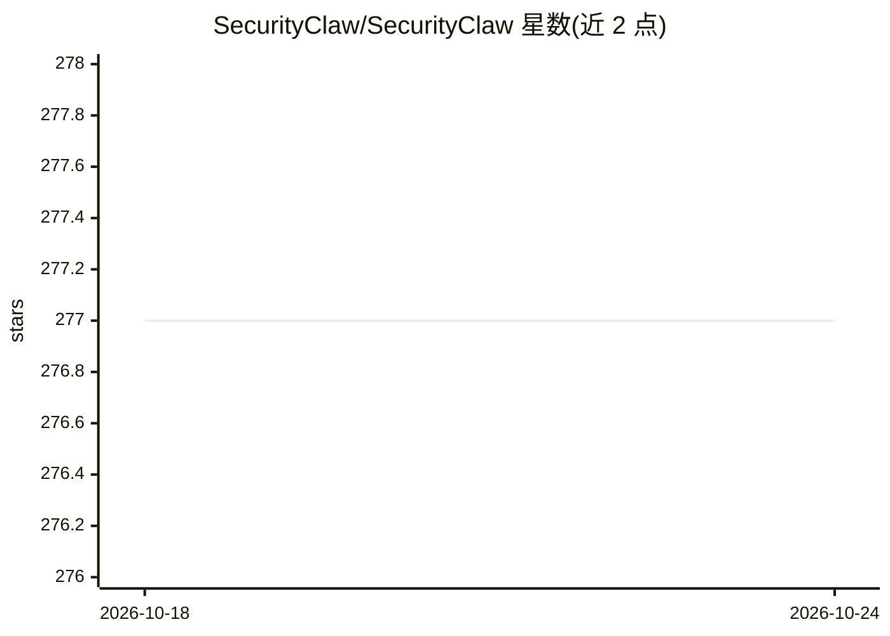

# SecurityClaw/SecurityClaw

⭐ 277 · Python · MIT · 推送 2026-10-19 · [GitHub](https://github.com/SecurityClaw/SecurityClaw) · 组织维护

**自主 SOC Agent：监控 OpenSearch/ES 日志并用 LLM 验证异常**

模块化、技能制的自主安全运营中心（SOC）Agent：以技能文件夹（logic.py + instruction.md）组织能力，通过 LangGraph 状态图编排 DECIDE→EXECUTE→EVALUATE 监督循环，用 APScheduler 定时运行异常监测与行为基线构建，基于 RAG 将向量嵌入存于 OpenSearch/Elasticsearch，用 LLM（Ollama 本地模型）对升级的异常给出威胁判定与 MITRE 战术映射。提供 React Web 界面、FastAPI、CLI 与 Docker 部署方式；部分技能标注为 In-Progress 状态，尚在验证中。

## 筛选速览

| 维度 | 判定 | 备注 |
|---|---|---|
| AI 角色 | `ai-native` | 本体是模型或模型工具 |
| 许可风险 | `permissive` | MIT |
| 部署形态 | `self-host` | docker 或自建部署 |
| 模型依赖 | local-ok | 支持本地模型 |
| 硬件要求 | — | 无带数字的原话,不猜 |
| 安装摩擦 | `low` | 无编译、无系统依赖或容器化 |
| 成熟度 | `idea` | |

## 能力要点

- 技能模块化：logic.py + instruction.md 自动发现加载
- LangGraph 状态图监督循环 + SQLite 会话检查点
- RAG 行为基线记忆存储于 OpenSearch/Elasticsearch 向量索引
- 威胁判定输出 MITRE 战术映射与推荐动作

## 适用场景

- 监控 OpenSearch/ES 日志流并自动分诊异常告警
- 通过对话式界面与 Web UI 调度安全技能调查威胁
- 构建网络行为基线用于上下文感知的威胁分析

## 场景标签

`网络安全` `RAG` · 领域:知识与检索

## 证据(README 行号)

> L7: A modular, skill-based autonomous Security Operations Center (SOC) agent that monitors OpenSearch/Elasticsearch data
> L41: * **LangGraph Orchestration** — Multi-step DECIDE→EXECUTE→EVALUATE supervisor loop implemented as a `StateGraph`; c
> L253:  - Request verdict (TRUE_THREAT, FALSE_POSITIVE, UNKNOWN, ERROR)

## 星数曲线

2026-10-18 277 → 2026-10-24 277（+0）

---
*卡片 v1 · prompt 1.4 · 生成 2026-10-22 · 置信度 mid · 依据 README sha `48d027fba1cf` · [字段定义](../../DATASET.md)*
