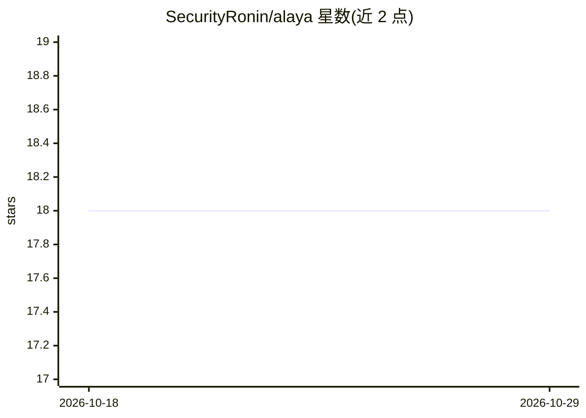

# SecurityRonin/alaya

⭐ 18 · Rust · MIT · 推送 2026-07-16 · [GitHub](https://github.com/SecurityRonin/alaya) · 个人维护

**面向 AI agent 的记忆引擎库：SQLite 单文件存储与遗忘**

以 Rust 编写、零外部服务依赖的可嵌入记忆引擎，数据存于单个 SQLite 文件。提供情景、语义、隐式偏好三类存储，机制包括 Bjork 双强度衰减遗忘、检索诱发抑制、Hebbian 共检索强化与基于 vasana 的偏好涌现；检索采用 BM25 与向量余弦混合排序，各能力可独立降级（无嵌入用 BM25、无 LLM 亦可运行）。以 MCP 服务器接入 Claude Code/Cursor 等客户端，并提供 npm、pip 与 crates.io 分发。供为 agent 构建记忆能力的开发者使用。

## 筛选速览

| 维度 | 判定 | 备注 |
|---|---|---|
| AI 角色 | `ai-ecosystem` | LLM/agent 周边工具 |
| 许可风险 | `permissive` | MIT |
| 部署形态 | `library` | 以包/库形式分发 |
| 模型依赖 | — | README 未给出锁定关系 |
| 硬件要求 | — | 无带数字的原话,不猜 |
| 安装摩擦 | `medium` | 含编译或系统依赖之一 |
| 成熟度 | — | 结构信号不足 |

## 能力要点

- 三类存储（情景/语义/隐式偏好）+ 单 SQLite 文件，无外部服务
- Bjork 双强度遗忘、检索诱发抑制、Hebbian 共检索强化
- 无嵌入/无 LLM 时逐级降级（BM25-only、情景累积）
- MCP 服务器提供 13 个记忆工具，含 Claude Code/claude-mem 数据导入

## 适用场景

- 给我的 Claude Code/Cursor agent 换掉 MEMORY.md 式全量注入的记忆
- 让 agent 在长期对话中检索相关记忆并自动遗忘过时内容
- 在 Rust/Python 应用中嵌入带遗忘与关联图的记忆层

## 场景标签

`Agent 记忆` · 领域:Agent 开发

## 证据(README 行号)

> L20: **Alaya** (Sanskrit: *alaya-vijnana*, "storehouse consciousness") is an
> L201: Alaya is a library, not a framework. Your agent owns the conversation loop,
> L76: The fastest way to add Alaya memory to any MCP-compatible agent (Claude Desktop,

## 星数曲线

2026-10-18 18 → 2026-10-29 18（+0）

---
*卡片 v1 · prompt 1.4 · 生成 2026-10-29 · 置信度 high · 依据 README sha `fdbfa070a218` · [字段定义](../../DATASET.md)*
