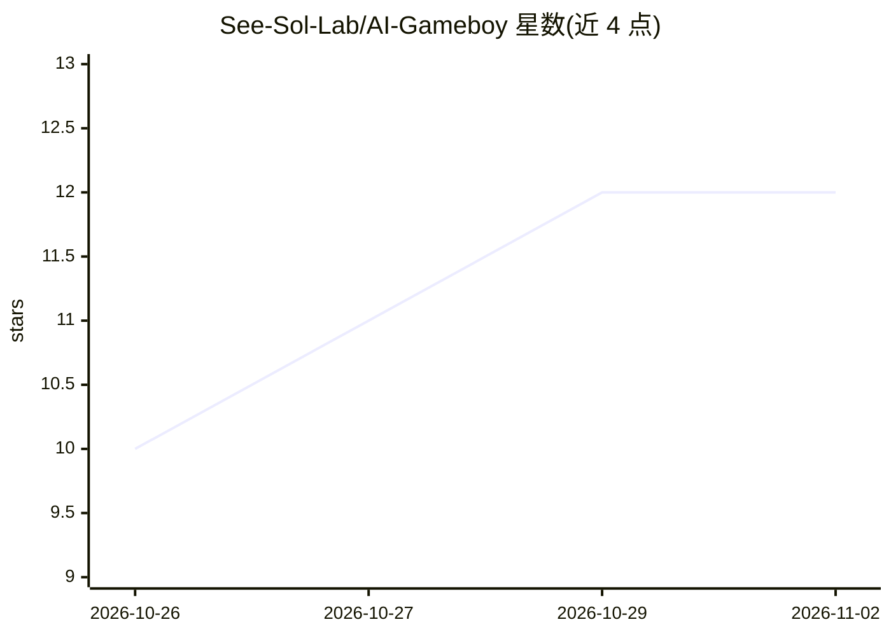

# See-Sol-Lab/AI-Gameboy

⭐ 12 · Python · NOASSERTION · 推送 2026-10-26 · [GitHub](https://github.com/See-Sol-Lab/AI-Gameboy) · 组织维护 · 中文 README

**给 AI 玩的复古掌机：AI 与人类联机玩文字游戏**

在电脑浏览器中运行的复古掌机应用，内置三款文字游戏：口袋穿越（AI 生成穿越世界）、口袋跑团（人类与 AI 合作解谜，掷骰判定）、口袋夜铺（AI 自主经营旧货店，人类旁观）。玩家通过邀请信息让本机或云端 AI 入座；穿越和跑团需另配一个模型服务密钥，夜铺不需要。另提供单文件盲玩版 pocket_night_shop.py，需 Python 3.11+。安装可交给能操作电脑的 AI（如 Claude Code、Codex）完成。采用 PolyForm Noncommercial 1.0.0 非商用许可，支持社区提交新卡带。

## 筛选速览

| 维度 | 判定 | 备注 |
|---|---|---|
| AI 角色 | `ai-native` | 本体是模型或模型工具 |
| 许可风险 | `none` | NOASSERTION |
| 部署形态 | `None` |  |
| 模型依赖 | — | README 未给出锁定关系 |
| 硬件要求 | — | 无带数字的原话,不猜 |
| 安装摩擦 | `low` | 无编译、无系统依赖或容器化 |
| 成熟度 | — | 结构信号不足 |

## 能力要点

- 三款内置文字游戏：AI 穿越改写故事、人机合作跑团、AI 自主经营店铺
- 人类可与 AI 同桌，或让两个 AI 组队由人类旁观
- 口袋夜铺提供单文件盲玩版（需 Python 3.11+，无需掌机网页）
- 存档保存在本地电脑，行动自动保存

## 适用场景

- 让 AI 经营一家旧货店，我在旁边看它的经营故事
- 和 AI 一起玩文字冒险跑团，合作调查解谜
- 让两个 AI 组队闯关，我当观众看剧情
- 把玩完的剧情整理成文字留作创作素材

## 场景标签

 · 领域:游戏/娱乐

## 证据(README 行号)

> L21: AI-Gameboy 是一台在电脑上打开的复古小掌机。初版内置三款文字游戏：AI 可以自己经营一家店，你也可以和它一起穿进小说、调查秘密；如果想当观众，就让两个 AI 组队，你坐在旁边看剧情。
> L34: |口袋穿越|人类和 AI，或两个 AI|穿进一个小说世界，试着改写原来的命运|
> L36: |口袋夜铺|一个 AI 当店主，人类旁观|淘旧物、修东西、接待客人，慢慢开出一家有故事的小店|

## 星数曲线

2026-10-26 10 → 2026-11-02 12（+2）

---
*卡片 v1 · prompt 1.4 · 生成 2026-11-01 · 置信度 high · 依据 README sha `8951a3544db4` · [字段定义](../../DATASET.md)*
