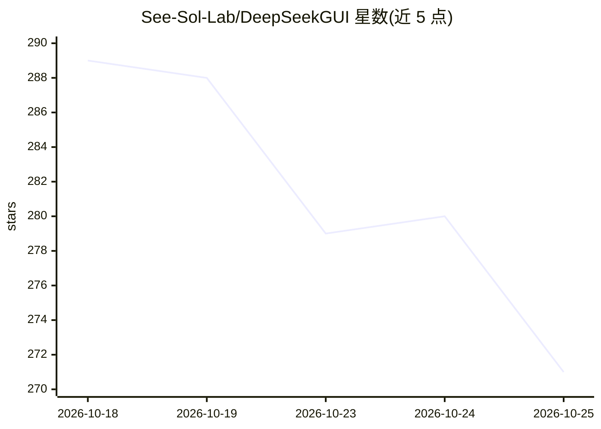

# See-Sol-Lab/DeepSeekGUI

⭐ 271 · TypeScript · NOASSERTION · 推送 2026-10-24 · [GitHub](https://github.com/See-Sol-Lab/DeepSeekGUI) · [官网](https://www.ailover-atlas.com/deepseekgui/) · 组织维护 · 中文 README

**基于 DeepSeek Harness 的本地 agentic 编程桌面工作台**

基于开源 DeepSeek Harness（DSH）构建的非官方桌面 GUI：用 DeepSeek 账号或 API key 登录后，在本地项目文件夹中让 AI 助手读取代码、修改文件、运行命令与浏览网页。产品层提供改动/Git 视图、worktree 并行工作区、提交推送与 PR 工具、全局与项目两级记忆（AGENTS.md/项目 memory.md）、内置浏览器、终端、文件预览与桌面通知。支持 DeepSeek V4.1 Flash 与自定义模型服务。产品层许可为 PolyForm Perimeter 1.0.1（上游 MIT）；Windows 提供安装包，Linux 提供 AppImage（实验性）。

## 筛选速览

| 维度 | 判定 | 备注 |
|---|---|---|
| AI 角色 | `ai-native` | 本体是模型或模型工具 |
| 许可风险 | `none` | NOASSERTION |
| 部署形态 | `desktop` | 安装包/桌面程序 |
| 模型依赖 | locked-api |  |
| 硬件要求 | — | 无带数字的原话,不猜 |
| 安装摩擦 | `low` | 无编译、无系统依赖或容器化 |
| 成熟度 | `idea` | |

## 能力要点

- AI 助手读取代码、改文件、运行命令、浏览网页的 agentic 工作台
- Git/PR 专用工具：改动分组视图、worktree 并行工作区、提交推送 PR
- 全局记忆+项目记忆两级上下文，会话可追溯实际使用的记忆内容
- 支持 DeepSeek V4.1 Flash 与自定义模型服务、图片附件

## 适用场景

- 在本地项目里让 AI 助手直接改代码并完成 Git 提交与 PR
- 通过全局/项目记忆延续跨会话与跨项目的协作偏好
- 在内置浏览器与文件预览旁监督助手的浏览与交付结果

## 场景标签

`编码 Agent` · 领域:编码与开发

## 证据(README 行号)

> L17: DeepSeekGUI 是基于 DeepSeek Harness 的本地 AI 工作台，用 DeepSeek 账号登录或配置模型 API key 后即可开始。选择项目文件夹，在会话中让助手读取代码、修改文件、运行命令和浏览网页；通
> L108: - **会话与权限** — 在项目文件夹中开始和恢复会话，查看工具执行过程，通过 Harness 权限模式和审批控制操作；回复正文平滑显示，停止或结束后立即显示完整内容。

## 星数曲线

2026-10-18 289 → 2026-10-25 271（-18）

---
*卡片 v1 · prompt 1.4 · 生成 2026-10-22 · 置信度 mid · 依据 README sha `9f315ea852ad` · [字段定义](../../DATASET.md)*
