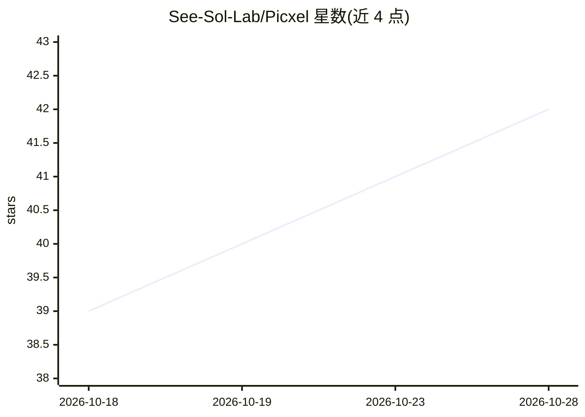

# See-Sol-Lab/Picxel

⭐ 42 · Python · GPL-3.0 · 推送 2026-10-19 · [GitHub](https://github.com/See-Sol-Lab/Picxel) · 组织维护 · 中文 README

**把参考图重绘为像素风游戏素材的 Codex 技能**

面向独立游戏开发者的 Codex 技能（SKILL.md）：GPT 解读参考图主体并指导重绘，本地算法完成调色板选择（Oklab 色差比较）与像素网格转换，导出 32/64/128 像素、每张最多 16 色的透明 PNG。需要带图像生成工具的 Codex 会话与 Python 3.10+，使用会话自身额度，无需单独 API key。支持单张预览与最多 20 张批量处理，提供英文/中文面板，另有可选 ComfyUI 导入导出节点。

## 筛选速览

| 维度 | 判定 | 备注 |
|---|---|---|
| AI 角色 | `ai-native` | 本体是模型或模型工具 |
| 许可风险 | `viral` | GPL-3.0 |
| 部署形态 | `None` |  |
| 模型依赖 | — | README 未给出锁定关系 |
| 硬件要求 | — | 无带数字的原话,不猜 |
| 安装摩擦 | `low` | 无编译、无系统依赖或容器化 |
| 成熟度 | — | 结构信号不足 |

## 能力要点

- GPT 主体解读 + 本地算法像素网格转换的两段流程
- 导出 32/64/128 像素透明 PNG，每张最多 16 色
- Oklab 感知色差调色板选择与网格单元内投票像素转换
- 支持最多 20 张批量处理与中英文面板

## 适用场景

- 把参考图转成可直接使用的像素风游戏素材
- 批量生成一套多尺寸（128/64/32）游戏精灵图
- 在 Codex 会话内通过对话驱动素材生成流程

## 场景标签

`图像生成` · 领域:内容生成

## 证据(README 行号)

> L13: Picxel helps indie game developers redraw references as recognizable game assets. GPT interprets the subject and di
> L41: You need a **Codex session with image-generation tools** and Python 3.10+. Picxel uses that session's tools and quo

## 星数曲线

2026-10-18 39 → 2026-10-28 42（+3）

---
*卡片 v1 · prompt 1.4 · 生成 2026-10-25 · 置信度 high · 依据 README sha `659bbabc8f80` · [字段定义](../../DATASET.md)*
