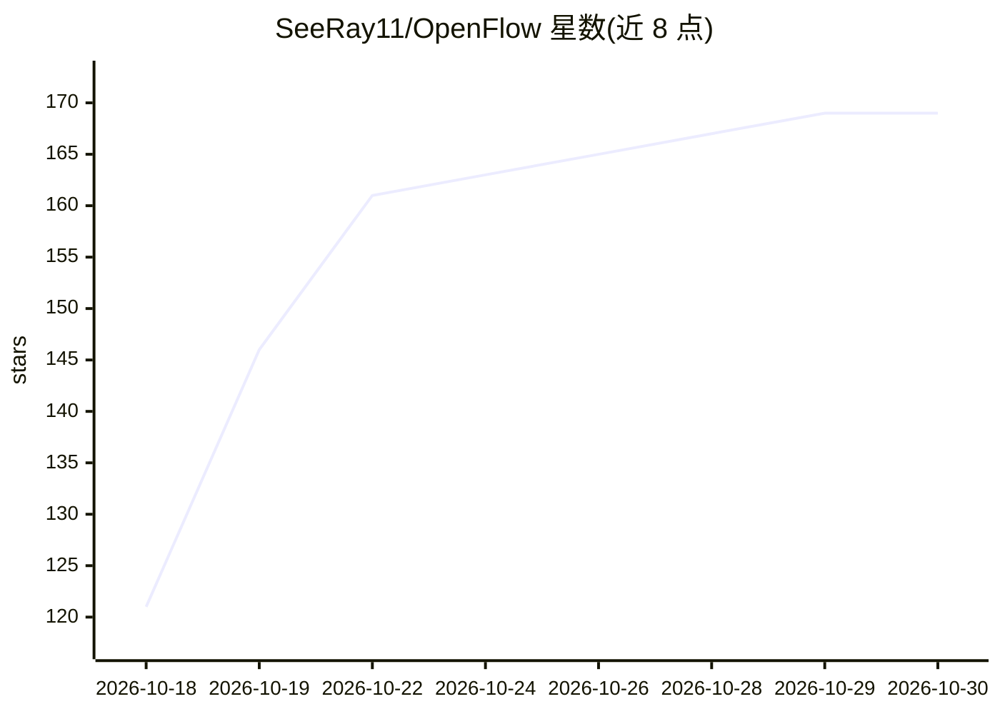

# SeeRay11/OpenFlow

⭐ 169 · TypeScript · MIT · 推送 2026-10-19 · [GitHub](https://github.com/SeeRay11/OpenFlow) · [官网](https://www.reddit.com/r/OpenFlowAI/) · 个人维护

**多智能体 AI 工作流的可视化编排器**

OpenFlow 是基于 opencode 引擎（通过 opencode serve 驱动）构建的独立 fork，自有代码位于 packages/flow，不修改上游包。用户在画布上拖放角色卡片、连线组成流水线（如 planner → architect → coder），保存后以并行智能体运行；智能体可读写真实文件。提供免费档模型（无需 key）、API key 连接对话框、节点级智能体生成与 MCP 支持。运行需 Bun ≥1.3，通过 git clone + bun install 从源码运行，占用 4096/5174 两个端口。

## 筛选速览

| 维度 | 判定 | 备注 |
|---|---|---|
| AI 角色 | `ai-ecosystem` | LLM/agent 周边工具 |
| 许可风险 | `permissive` | MIT |
| 部署形态 | `desktop` | 安装包/桌面程序 |
| 模型依赖 | — | README 未给出锁定关系 |
| 硬件要求 | — | 无带数字的原话,不猜 |
| 安装摩擦 | `low` | 无编译、无系统依赖或容器化 |
| 成熟度 | — | 结构信号不足 |

## 能力要点

- 画布拖放编排多智能体流水线并并行运行
- 基于 opencode headless 引擎，代码隔离在 packages/flow，上游合并不受影响
- 免费档模型可无 key 立即运行，付费模型需连接 API key
- 画布可托管引擎，一键重启以应用合并的 agent、技能与 MCP 变更

## 适用场景

- 用可视化画布编排 planner→architect→coder 式编码流水线
- 在指定仓库中让多个并行 agent 读写真实文件完成任务
- 无 API key 时先用免费档模型试用多智能体工作流

## 场景标签

`多智能体` `编码 Agent` · 领域:Agent 开发

## 证据(README 行号)

> L3: **OpenFlow is a visual builder for multi-agent AI workflows.** Drag role cards
> L10: opencode, whose headless engine
> L11: (`opencode serve`) drives the agents underneath. All of OpenFlow's own code lives

## 星数曲线

2026-10-18 121 → 2026-10-30 169（+48）

---
*卡片 v1 · prompt 1.4 · 生成 2026-10-22 · 置信度 high · 依据 README sha `fb6cf37eb267` · [字段定义](../../DATASET.md)*
