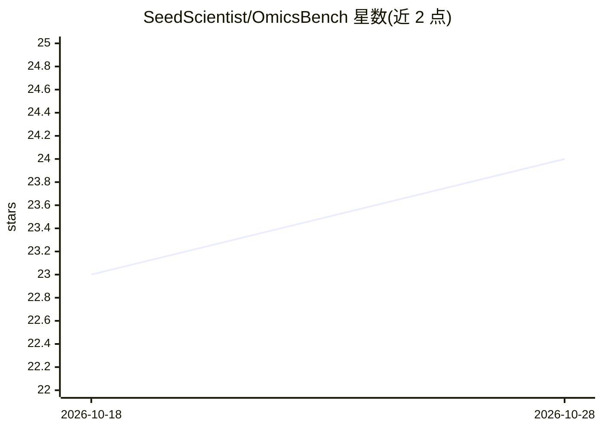

# SeedScientist/OmicsBench

⭐ 24 · Python · 推送 2026-09-24 · [GitHub](https://github.com/SeedScientist/OmicsBench) · 组织维护 · 中文 README

**评估 LLM 生物推理的多组学序列基准（1,160 题专家验证）**

用于评估大语言模型在 DNA 调控、RNA 加工与蛋白质功能六类任务上科学推理能力的基准：包含 1,160 道专家验证题目，除预测指标（MCC/AUC/Acc/F-max）外还要求模型给出可溯源的证据链，用实例级评分标准评估推理质量。数据集经多智能体框架合成并由机器检查与专家评审两级验证，托管于 Hugging Face 与 ModelScope，附 arXiv 论文与配套 TA-OPD-27B 模型。README 未提供安装运行命令。

## 筛选速览

| 维度 | 判定 | 备注 |
|---|---|---|
| AI 角色 | `ai-knowledge` | 知识聚合/清单类 |
| 许可风险 | `none` | — |
| 部署形态 | `None` |  |
| 模型依赖 | — | README 未给出锁定关系 |
| 硬件要求 | — | 无带数字的原话,不猜 |
| 安装摩擦 | `low` | 无编译、无系统依赖或容器化 |
| 成熟度 | — | 结构信号不足 |

## 能力要点

- 1,160 道专家验证题目，覆盖中心法则六类组学任务
- 除预测指标外评估可溯源推理链（instance-specific rubrics）
- 多智能体合成框架生成推理链，机器检查+专家评审两级验证
- 附带评测结果表：专有/开源/科学 LLM 三类模型对比

## 适用场景

- 评估 LLM 在组学任务上是统计捷径还是真实生物推理
- 比较通用 LLM 与科学专用 LLM 的组学推理表现
- 为组学领域模型选型提供预测+推理双维度参考

## 场景标签

`模型评测` · 领域:评测与运维

## 证据(README 行号)

> L24: **OmicsBench** is a pioneering benchmark designed to evaluate the scientific reasoning capabilities of Large Langua
> L33: - Comprising **1,160 expert-validated questions**.
> L34: - Covering **six biologically coherent tasks**.

## 星数曲线

2026-10-18 23 → 2026-10-28 24（+1）

---
*卡片 v1 · prompt 1.4 · 生成 2026-10-27 · 置信度 high · 依据 README sha `8ba6d6a2a953` · [字段定义](../../DATASET.md)*
