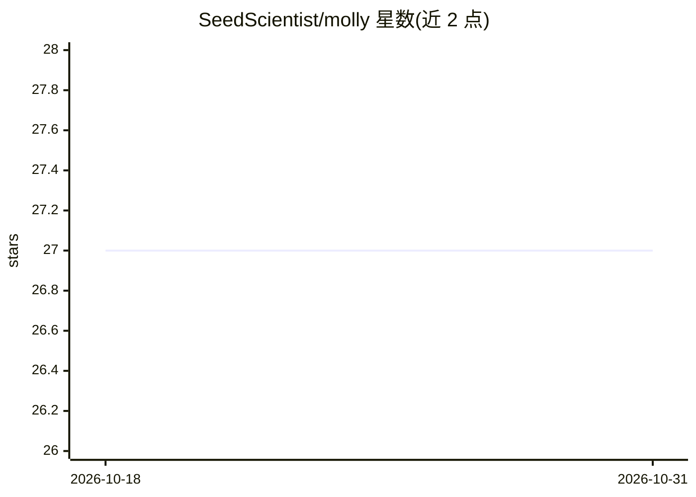

# SeedScientist/molly

⭐ 27 · Python · Apache-2.0 · 推送 2025-12-23 · [GitHub](https://github.com/SeedScientist/molly) · 组织维护 · 中文 README

**多组学大语言模型：理解 DNA、RNA 与蛋白质序列**

Molly 是一个由多个编码器组成的语言模型：以增强版 Qwen3 为基座，接入 nucleotide-transformer（DNA/RNA）与 ESM-2（蛋白质）编码器，用于理解多组学序列数据。提供 1.7B/4B/8B 三个规模的可下载权重，训练支持 Liger-Kernel 与 FlashAttention 加速，并附带推理、训练与评测的脚本流程（含 swanlab 实验跟踪、transformers 源码热修步骤）。许可证为 Apache。

## 筛选速览

| 维度 | 判定 | 备注 |
|---|---|---|
| AI 角色 | `ai-native` | 本体是模型或模型工具 |
| 许可风险 | `permissive` | Apache-2.0 |
| 部署形态 | `None` |  |
| 模型依赖 | — | README 未给出锁定关系 |
| 硬件要求 | — | 无带数字的原话,不猜 |
| 安装摩擦 | `low` | 无编译、无系统依赖或容器化 |
| 成熟度 | — | 结构信号不足 |

## 能力要点

- 基座为增强版 Qwen3，集成 nucleotide-transformer 与 ESM-2 编码器
- 提供 1.7B / 4B / 8B 三档预训练权重下载
- 支持 Liger-Kernel 与 FlashAttention 训练加速
- 附带推理、训练与评测的完整脚本流程

## 适用场景

- 对 DNA、RNA、蛋白质多组学任务进行推理与评测
- 在官方权重基础上继续训练或微调多组学模型
- 复现多模态组学模型的评测流程

## 场景标签

`多模态` `模型训练` · 领域:感知与多模态

## 证据(README 行号)

> L5: Molly is a Large Language Model composed of multiple encoders, capable of understanding multi-omics data (DNA, RNA, 
> L12: - **Base Model**: Enhanced Qwen3 with nucleotide-transformer and ESM-2 encoders

## 星数曲线

2026-10-18 27 → 2026-10-31 27（+0）

---
*卡片 v1 · prompt 1.4 · 生成 2026-10-26 · 置信度 high · 依据 README sha `184c8419f6d3` · [字段定义](../../DATASET.md)*
