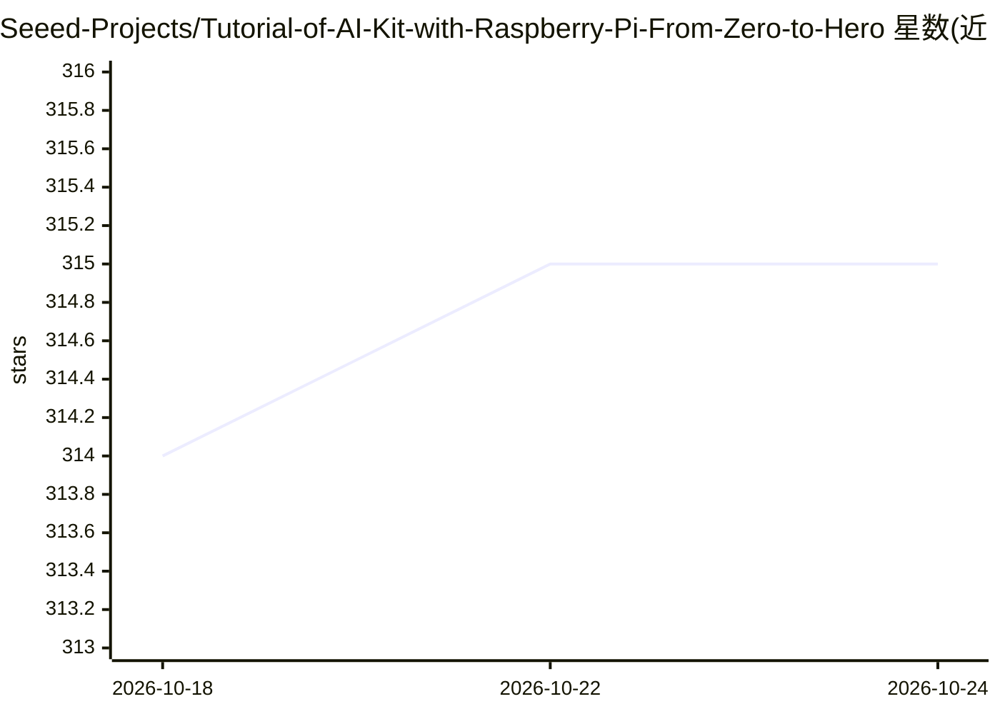

# Seeed-Projects/Tutorial-of-AI-Kit-with-Raspberry-Pi-From-Zero-to-Hero

⭐ 315 · Jupyter Notebook · MIT · 推送 2026-01-21 · [GitHub](https://github.com/Seeed-Projects/Tutorial-of-AI-Kit-with-Raspberry-Pi-From-Zero-to-Hero) · [官网](https://seeed-projects.github.io/Tutorial-of-AI-Kit-with-Raspberry-Pi-From-Zero-to-Hero/) · 组织维护

**树莓派 AI Kit 从入门到进阶的计算机视觉/LLM 教程课程**

Seeed Projects 维护的分章教程仓库：教授在 Raspberry Pi 上利用 AI Kit（Hailo NPU）运行计算机视觉任务与 LLM，内容涵盖 AI 基础概念、PyTorch/TensorFlow/OpenCV/Ultralytics/Hailo 环境入门、用 Hailo 运行检测与 CLIP 应用、通过 Ollama 运行 Llama/Gemma2/Phi3.5 等模型，以及模型训练-转换-部署流程和智慧零售、停车场管理等 IoT 实战项目。面向爱好者、学生与专业人士，前置要求列出 reComputer 与 AI Kit 等硬件。

## 筛选速览

| 维度 | 判定 | 备注 |
|---|---|---|
| AI 角色 | `ai-knowledge` | 知识聚合/清单类 |
| 许可风险 | `permissive` | MIT |
| 部署形态 | `None` |  |
| 模型依赖 | — | README 未给出锁定关系 |
| 硬件要求 | — | 无带数字的原话,不猜 |
| 安装摩擦 | `low` | 无编译、无系统依赖或容器化 |
| 成熟度 | — | 结构信号不足 |

## 能力要点

- 分章路线图覆盖 AI 基础、框架入门到部署实战
- Hailo NPU 上运行 CLIP 等视觉任务与自定义模型部署
- Ollama 运行 Llama/Gemma2/Phi3.5 及多模态模型并配合 Python 使用
- 智慧零售、停车场管理等 AIoT 实战项目

## 适用场景

- 跟着教程在树莓派 AI Kit 上跑目标检测与图像分类
- 在树莓派上用 Ollama 部署本地 LLM
- 学习自定义模型的训练、转换与 Hailo NPU 部署流程

## 场景标签

`教程课程` `目标检测` · 领域:学习与行业

## 证据(README 行号)

> L24: This course is designed to teach you how to harness the power of AI on the Raspberry Pi, with a particular focus on
> L82: ### Chapter 1 [In Progress, Expected Completion: November 2024]

## 星数曲线

2026-10-18 314 → 2026-10-24 315（+1）

---
*卡片 v1 · prompt 1.4 · 生成 2026-10-21 · 置信度 high · 依据 README sha `06ee280b1f20` · [字段定义](../../DATASET.md)*
