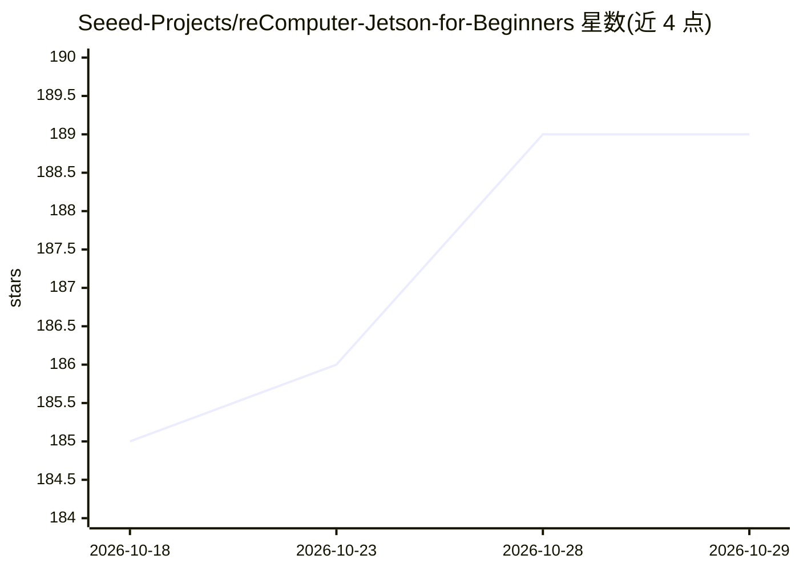

# Seeed-Projects/reComputer-Jetson-for-Beginners

⭐ 189 · Python · MIT · 推送 2026-08-06 · [GitHub](https://github.com/Seeed-Projects/reComputer-Jetson-for-Beginners) · 组织维护

**面向初学者的 Jetson Orin 边缘 AI 教学课程（10 个模块）**

Seeed 维护的 reComputer Jetson Orin 入门教程仓库：以 10 个模块覆盖平台概览、基础工具、计算机视觉、离线大模型开发、生成式 AI、ROS 机器人与算法优化部署，涉及 CUDA、JetPack SDK、TensorRT、DeepStream、PyTorch/TensorFlow 等技术栈，并含端到端 NVR 系统、自主移动机器人、部署 Llama 3 与 Ollama 搭建聊天机器人等实践项目。要求读者具备 Linux 基础并拥有 Jetson Orin 设备（推荐至少 8GB 内存）。

## 筛选速览

| 维度 | 判定 | 备注 |
|---|---|---|
| AI 角色 | `ai-knowledge` | 知识聚合/清单类 |
| 许可风险 | `permissive` | MIT |
| 部署形态 | `None` |  |
| 模型依赖 | — | README 未给出锁定关系 |
| 硬件要求 | — | 无带数字的原话,不猜 |
| 安装摩擦 | `medium` | 含编译或系统依赖之一 |
| 成熟度 | — | 结构信号不足 |

## 能力要点

- 10 个模块覆盖视觉、生成式 AI、机器人与部署优化
- 实践项目含 NVR 系统、AMR 机器人与本地 LLM 聊天机器人
- 覆盖 CUDA / JetPack / TensorRT / DeepStream 技术栈

## 适用场景

- 跟随系统课程从零学习 Jetson 边缘 AI 开发
- 在 Jetson 设备上部署大模型和计算机视觉应用
- 动手搭建 NVR 视频分析或 ROS 机器人项目

## 场景标签

`教程课程` · 领域:学习与行业

## 证据(README 行号)

> L3: Welcome to the reComputer Jetson Orin Beginner Guide! Dive deep into the NVIDIA Jetson Orin platform with this compr
> L40: ## 📚 Table of Contents
> L43: |**Chapter**|**Content**|

## 星数曲线

2026-10-18 185 → 2026-10-29 189（+4）

---
*卡片 v1 · prompt 1.4 · 生成 2026-10-22 · 置信度 high · 依据 README sha `a3415598f78c` · [字段定义](../../DATASET.md)*
