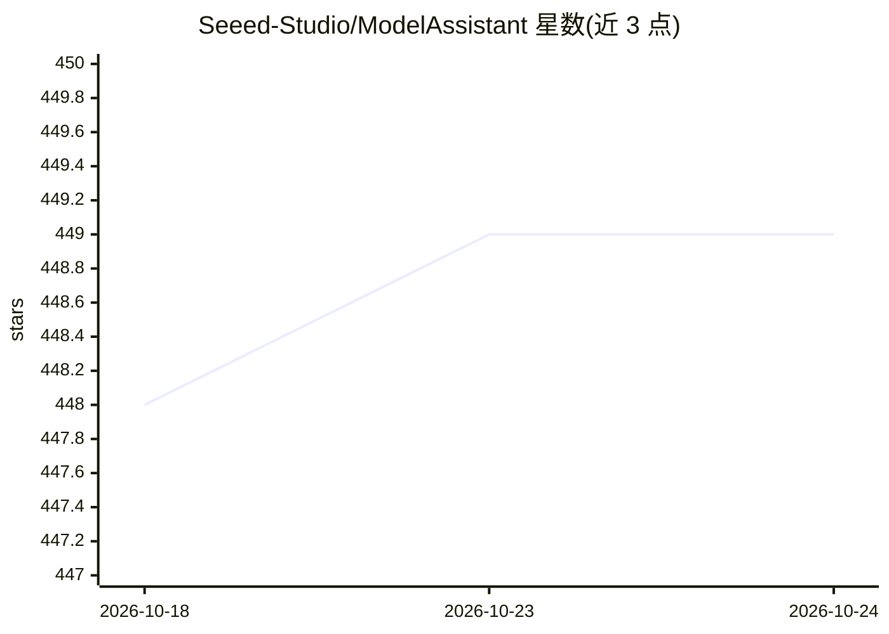

# Seeed-Studio/ModelAssistant

⭐ 449 · Python · 推送 2026-09-04 · [GitHub](https://github.com/Seeed-Studio/ModelAssistant) · [官网](https://sensecraftma.seeed.cc/) · 组织维护 · 中文 README

**面向嵌入式设备的 AI 模型训练与部署开源工具链**

Seeed Studio 维护的嵌入式 AI 项目：将 OpenMMLab 等来源的算法（目标检测、图像分类、分割、姿态估计、异常检测、仪表识别、音频分类）优化后部署到低成本硬件，支持 ESP32、Arduino 开发板、树莓派等 MCU 与单板机。提供完整工具链：预训练模型库 Model Zoo、网页端训练部署工具（现更名 SenseCraft AI）、跨平台 MCU 部署框架 SSCMA-Micro、Arduino 库与 Python 交互库。模型可导出 TFLite/ONNX，并可转换为 TensorRT、UF2 拖拽烧录部署。基于 Apache 2.0 许可发布。

## 筛选速览

| 维度 | 判定 | 备注 |
|---|---|---|
| AI 角色 | `ai-ecosystem` | LLM/agent 周边工具 |
| 许可风险 | `none` | — |
| 部署形态 | `None` |  |
| 模型依赖 | — | README 未给出锁定关系 |
| 硬件要求 | — | 无带数字的原话,不猜 |
| 安装摩擦 | `low` | 无编译、无系统依赖或容器化 |
| 成熟度 | — | 结构信号不足 |

## 能力要点

- 算法优化后可部署到功耗低于 0.3 瓦的 MCU
- 支持 TFLite/ONNX 导出及 TensorRT、UF2 拖拽部署
- 覆盖检测/分类/分割/姿态/异常检测/仪表识别等算法（含 RTMDet、YOLOv8、Swift YOLO）
- 配套 Model Zoo、Web 工具、SSCMA-Micro、Arduino/Python 库的完整工具链

## 适用场景

- 在 ESP32、Arduino、树莓派等低成本硬件上训练并部署视觉模型
- 工业场景识别模拟/数字仪表读数
- 低功耗设备上的异常检测与音频分类

## 场景标签

`目标检测` `微调` · 领域:感知与多模态

## 证据(README 行号)

> L18: **S**eeed **S**ense**C**raft **M**odel **A**ssistant is an open-source project focused on providing state-of-the-ar
> L72: ## The SSCMA Toolchains
> L74: SSCMA provides a complete toolchain for users to easily deploy AI models on low-cost hardwares, including:

## 星数曲线

2026-10-18 448 → 2026-10-24 449（+1）

---
*卡片 v1 · prompt 1.4 · 生成 2026-10-21 · 置信度 high · 依据 README sha `3fea06dc9415` · [字段定义](../../DATASET.md)*
