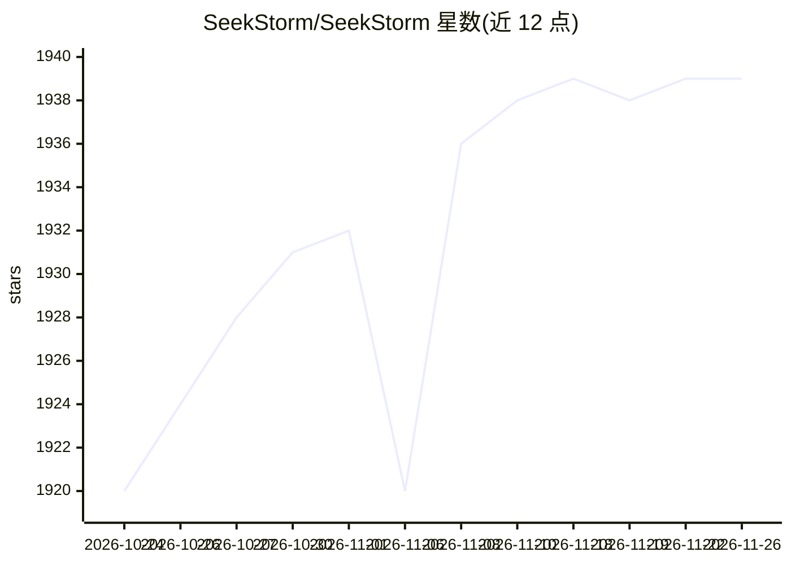

# SeekStorm/SeekStorm

⭐ 1,939 · Rust · Apache-2.0 · 推送 2026-11-24 · [GitHub](https://github.com/SeekStorm/SeekStorm) · [官网](https://seekstorm.com) · 个人维护

**为开发者提供毫秒级词法/向量/混合搜索的 Rust 库与多租户服务器**

用 Rust 实现的搜索组件：以库形式嵌入应用，也可作为多租户服务器运行，并提供 MCP server 供 AI agent 检索。双引擎架构（倒排索引 + IVF ANN）经同一查询规划器按查询提供词法（BM25F）、向量或混合搜索，用 RRF 融合结果。支持实时索引、分面、地理搜索、纠错补全、SIMD 加速与十亿级索引。提供 REST API、内嵌 Web UI、CSV/JSON/NDJSON/PDF 摄取及 Python/TypeScript/Rust/C#/Java SDK，Apache 2.0 许可。

## 筛选速览

| 维度 | 判定 | 备注 |
|---|---|---|
| AI 角色 | `ai-ecosystem` | LLM/agent 周边工具 |
| 许可风险 | `permissive` | Apache-2.0 |
| 部署形态 | `desktop` | 安装包/桌面程序 |
| 模型依赖 | — | README 未给出锁定关系 |
| 硬件要求 | — | 无带数字的原话,不猜 |
| 安装摩擦 | `low` | 无编译、无系统依赖或容器化 |
| 成熟度 | — | 结构信号不足 |

## 能力要点

- 词法（BM25F）、向量（IVF ANN）、混合搜索（RRF 融合）三种查询模式
- 内嵌 Model2Vec 推理生成嵌入，或导入外部嵌入；支持 F32/I8 与量化
- 内置 MCP server，向 AI agent 暴露搜索、摄取与索引管理工具
- 多租户服务器含 REST API、内嵌 Web UI 与多语言客户端 SDK

## 适用场景

- 给应用或网站添加带分面、纠错和即时搜索的产品/站点搜索
- 为 RAG 与 agent 提供经 MCP 的混合检索
- 对自有 JSON/CSV/NDJSON/PDF 数据构建搜索引擎
- 以库形式嵌入应用内搜索，无需运行服务器

## 场景标签

`RAG` `语义搜索` · 领域:知识与检索

## 证据(README 行号)

> L4: Embed as a library, run as a multi-tenant server, or give your agents search via MCP.
> L48: |🤖 **Agent-ready**|Built-in MCP server for RAG and agentic search.|
> L95: * MCP server for agentic search

## 星数曲线

2026-10-24 1,920 → 2026-11-26 1,939（+19）

---
*卡片 v1 · prompt 1.4 · 生成 2026-11-24 · 置信度 mid · 依据 README sha `de1cbc7cc326` · [字段定义](../../DATASET.md)*
