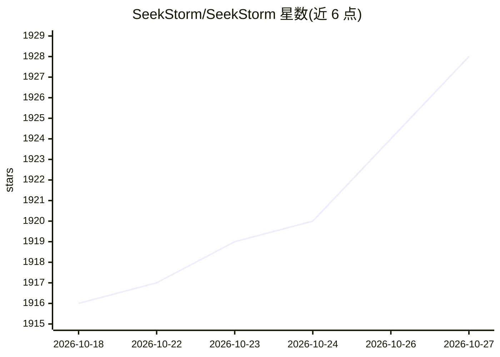

# SeekStorm/SeekStorm

⭐ 1,928 · Rust · Apache-2.0 · 推送 2026-10-26 · [GitHub](https://github.com/SeekStorm/SeekStorm) · [官网](https://seekstorm.com) · 个人维护

**Rust 实现的词法/向量/混合搜索引擎库与多租户服务器**

以 Rust 编写的搜索引擎，同一套查询规划器下并列运行倒排索引（BM25F/BM25F_Proximity）与分片分层 IVF ANN 索引，词法、向量或混合检索可按查询选择，用 RRF 融合；内置 Model2Vec 嵌入推理或导入外部 embeddings。可嵌入为库（cargo add）、以 Docker 运行多租户 REST 服务器（含 Web UI、CSV/JSON/NDJSON/PDF 摄取、API key 管理），或通过内置 MCP server 为 AI agent 提供 RAG 检索。支持中文分词、38 语言词干化、faceting、地理检索、容错，Apache 2.0，自 2020 年生产使用。

## 筛选速览

| 维度 | 判定 | 备注 |
|---|---|---|
| AI 角色 | `ai-ecosystem` | LLM/agent 周边工具 |
| 许可风险 | `permissive` | Apache-2.0 |
| 部署形态 | `desktop` | 安装包/桌面程序 |
| 模型依赖 | — | README 未给出锁定关系 |
| 硬件要求 | — | 无带数字的原话,不猜 |
| 安装摩擦 | `low` | 无编译、无系统依赖或容器化 |
| 成熟度 | — | 结构信号不足 |

## 能力要点

- 双引擎（倒排索引 + IVF ANN）统一查询规划器，RRF 融合的按查询混合检索
- 内置 Model2Vec 嵌入推理，或导入外部生成的 embeddings
- 多租户 REST 服务器：Docker 镜像、嵌入式 Web UI、CSV/JSON/NDJSON/PDF 摄取、API key 管理
- 内置 MCP server，为 Claude Desktop、Cursor 等 agent 客户端暴露检索与索引工具

## 适用场景

- 为应用或网站做带 faceting、容错与即时搜索的产品/站点搜索
- 给 RAG 与 agent 提供实时可检索的混合检索后端
- 把检索能力作为库直接链接进自己的程序，无需单独部署服务器

## 场景标签

`语义搜索` · 领域:知识与检索

## 证据(README 行号)

> L4: Embed it as a library, run it as a server, or give your agents search via MCP.
> L47: |🤖 **Agent-ready**|Built-in MCP server for RAG and agentic search.|
> L203: * **RAG and agent retrieval**: hybrid search over MCP, searchable the moment a document is indexed.

## 星数曲线

2026-10-18 1,916 → 2026-10-27 1,928（+12）

---
*卡片 v1 · prompt 1.4 · 生成 2026-10-21 · 置信度 mid · 依据 README sha `a82a655d6cb0` · [字段定义](../../DATASET.md)*
