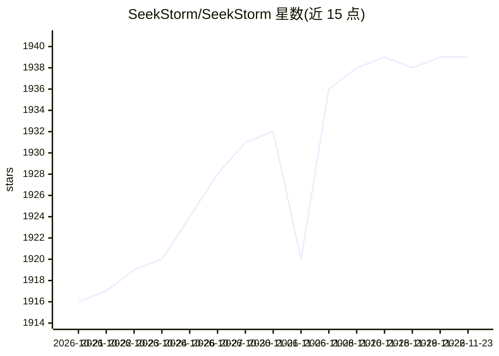

# SeekStorm/SeekStorm

⭐ 1,939 · Rust · Apache-2.0 · 推送 2026-11-16 · [GitHub](https://github.com/SeekStorm/SeekStorm) · [官网](https://seekstorm.com) · 组织维护

**为应用与 AI 代理提供毫秒级词法/向量/混合搜索的 Rust 库与服务器**

以 Rust 编写的搜索引擎，可作为进程内库嵌入、作为多租户服务器运行，或通过内置 MCP 服务器向 AI 代理提供搜索。包含两套原生索引架构（倒排索引与 IVF ANN），支持逐查询的词法、向量或混合搜索（RRF 融合）。功能覆盖 BM25F 排序、6 种分词器（含中文分词）、38 种语言的词干提取、多向量索引、量化、分面、地理搜索、容错与实时索引。通过 crates.io、cargo 与 Docker 分发，附带 Python/TypeScript/Rust/C#/Java SDK。

## 筛选速览

| 维度 | 判定 | 备注 |
|---|---|---|
| AI 角色 | `ai-ecosystem` | LLM/agent 周边工具 |
| 许可风险 | `permissive` | Apache-2.0 |
| 部署形态 | `desktop` | 安装包/桌面程序 |
| 模型依赖 | — | README 未给出锁定关系 |
| 硬件要求 | — | 无带数字的原话,不猜 |
| 安装摩擦 | `low` | 无编译、无系统依赖或容器化 |
| 成熟度 | `idea` | |

## 能力要点

- 两种一等搜索引擎（倒排 + IVF ANN）由一个查询规划器结合，支持逐查询的词法/向量/混合搜索及 RRF 融合
- 内置用于 RAG 和代理搜索的 MCP 服务器（cargo install seekstorm_mcp_server）
- 真·实时索引：文档在提交过程中或之前即可被搜索
- 多租户 REST API 服务器，支持嵌入式 Web UI，支持 CSV/JSON/NDJSON/PDF 摄取

## 适用场景

- 为我的应用或网站添加带有分面、容错和即时搜索的产品/站点搜索
- 通过 MCP 为我的 AI 代理或 RAG 流水线提供混合搜索
- 在我的 Rust 应用中直接嵌入搜索库，无需服务器
- 在私有数据（JSON/CSV/PDF）上构建搜索引擎

## 场景标签

`语义搜索` · 领域:知识与检索

## 证据(README 行号)

> L4: Embed as a library, run as a multi-tenant server, or give your agents search via MCP.
> L48: |🤖 **Agent-ready**|Built-in MCP server for RAG and agentic search.|
> L95: * MCP server for agentic search

## 星数曲线

2026-10-21 1,916 → 2026-11-23 1,939（+23）

---
*卡片 v1 · prompt 1.4 · 生成 2026-11-23 · 置信度 mid · 依据 README sha `5ce32ca898d0` · [字段定义](../../DATASET.md)*
