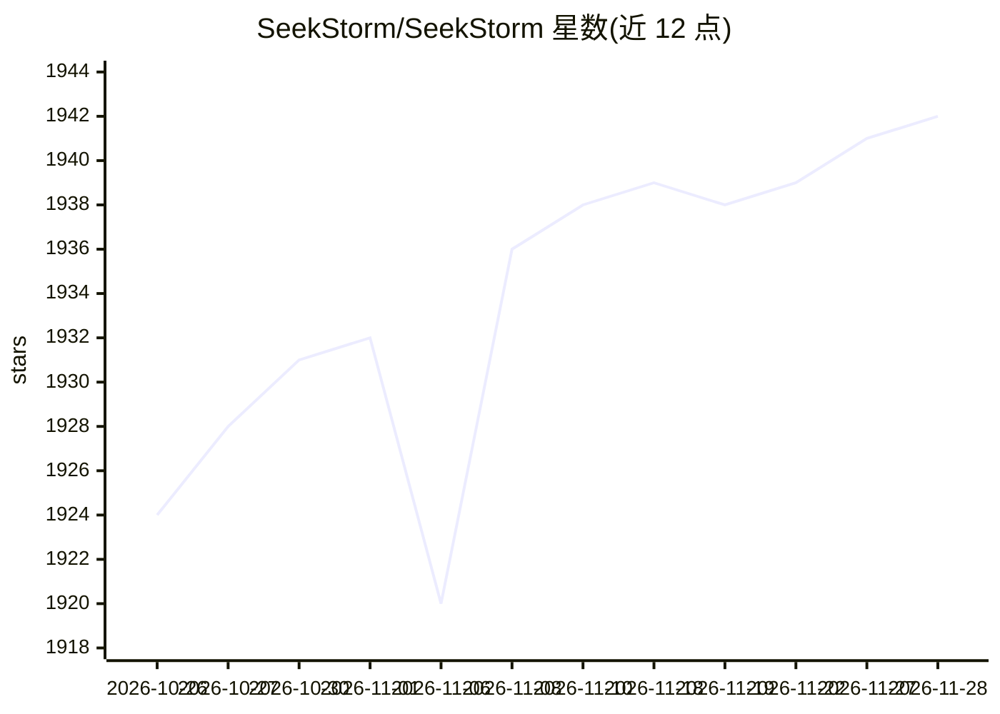

# SeekStorm/SeekStorm

⭐ 1,942 · Rust · Apache-2.0 · 推送 2026-11-26 · [GitHub](https://github.com/SeekStorm/SeekStorm) · [官网](https://seekstorm.com) · 个人维护

**Rust 编写的词法/向量/混合搜索库与多租户服务器**

Rust 实现的搜索引擎，以三种形态提供：嵌入进程的库、多租户 REST API 服务器、供 AI agent 调用的 MCP 服务器。词法侧提供 BM25F 排序、6 种分词器（含中文分词）、38 语言词干化与 N-gram 短语索引；向量侧提供多向量索引、Model2Vec 内置推理或外部嵌入导入、IVF 分片索引与量化；两种索引由一个查询规划器融合（RRF）。支持实时索引、分面、地理邻近、纠错补全、CSV/JSON/NDJSON/PDF 摄取，Apache 2.0 许可，2020 年起在生产使用。

## 筛选速览

| 维度 | 判定 | 备注 |
|---|---|---|
| AI 角色 | `ai-enhanced` | 去掉 AI 部分产品仍成立 |
| 许可风险 | `permissive` | Apache-2.0 |
| 部署形态 | `desktop` | 安装包/桌面程序 |
| 模型依赖 | — | README 未给出锁定关系 |
| 硬件要求 | — | 无带数字的原话,不猜 |
| 安装摩擦 | `low` | 无编译、无系统依赖或容器化 |
| 成熟度 | — | 结构信号不足 |

## 能力要点

- 词法+向量双引擎经 RRF 融合的混合搜索，分面与过滤在向量检索期间生效
- 内嵌 Model2Vec 推理生成嵌入，或导入外部嵌入（F32/I8、多种相似度度量）
- 内置 MCP 服务器，为 agent/RAG 暴露搜索与索引工具
- 同一二进制索引在库、服务器、云之间通用，无需重建索引

## 适用场景

- 为应用或网站搭建带分面、纠错、即时搜索的产品/站点搜索
- 为 RAG 和 agent 提供经 MCP 接入的混合检索
- 在自己的 JSON/CSV/NDJSON/PDF 数据上构建搜索引擎
- 将搜索库直接嵌入应用内运行，无需独立服务器

## 场景标签

`语义搜索` · 领域:知识与检索

## 证据(README 行号)

> L4: Embed as a library, run as a multi-tenant server, or give your agents search via MCP.
> L48: |🤖 **Agent-ready**|Built-in MCP server for RAG and agentic search.|
> L177: The MCP server runs as a child process over stdio and embeds SeekStorm directly: no server process or network conn

## 星数曲线

2026-10-26 1,924 → 2026-11-28 1,942（+18）

---
*卡片 v1 · prompt 1.4 · 生成 2026-11-26 · 置信度 mid · 依据 README sha `1fb92538497b` · [字段定义](../../DATASET.md)*
