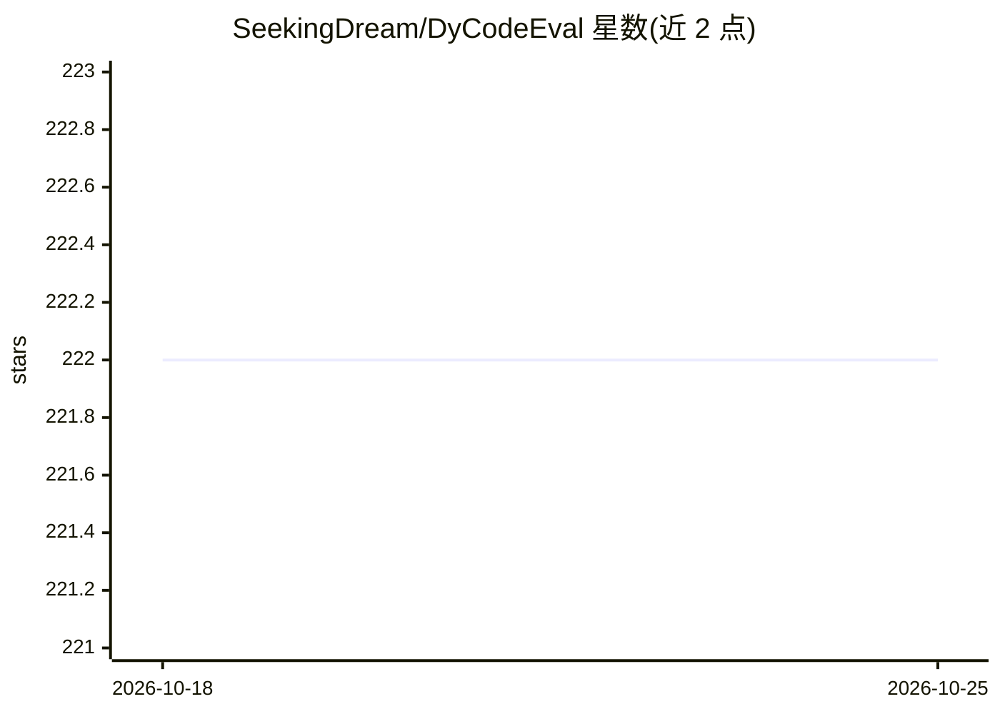

# SeekingDream/DyCodeEval

⭐ 222 · Python · 推送 2025-12-23 · [GitHub](https://github.com/SeekingDream/DyCodeEval) · [官网](https://arxiv.org/abs/2503.04149) · 组织维护

**动态评测代码 LLM 推理能力的基准框架，缓解数据污染**

ICML 2025 论文的官方实现：利用多智能体协作在评测时重写现有编程基准（HumanEval/MBPP），生成语义等价、多样化、非确定性的新题，以缓解数据污染；配套动态指标 DyPass@K。问题生成依赖 Claude 3.5 Haiku/Sonnet（经 litellm 调用），推理侧抽象支持 vLLM 与 LiteLLM。提供论文全部实验复现脚本与 Hugging Face 预生成数据集，README 自述当前脚本较为分散、未来将统一，并计划通过微调开源模型摆脱 Claude API 依赖。

## 筛选速览

| 维度 | 判定 | 备注 |
|---|---|---|
| AI 角色 | `ai-ecosystem` | LLM/agent 周边工具 |
| 许可风险 | `none` | — |
| 部署形态 | `library` | 以包/库形式分发 |
| 模型依赖 | local-ok | 支持本地模型 |
| 硬件要求 | — | 无带数字的原话,不猜 |
| 安装摩擦 | `low` | 无编译、无系统依赖或容器化 |
| 成熟度 | — | 结构信号不足 |

## 能力要点

- 评测时动态重写基准题（语义等价/多样化/非确定）
- DyPass@K 动态指标计算流程
- 提供 HumanEval 与 MBPP 预生成数据集
- 含模拟数据污染的过拟合训练脚本

## 适用场景

- 评测代码 LLM 时降低数据污染影响
- 复现论文中的基准实验
- 生成动态编程题集做模型对比

## 场景标签

`模型评测` · 领域:评测与运维

## 证据(README 行号)

> L10: **DyCodeEval** proposes a novel **dynamic benchmarking framework (dynamic evaluation dataset + dynamic metric)** fo
> L64: To compute the dynamic metric `DyPass@K`, first run `python gen_problem.py` to generate multiple versions of the be

## 星数曲线

2026-10-18 222 → 2026-10-25 222（+0）

---
*卡片 v1 · prompt 1.4 · 生成 2026-10-22 · 置信度 high · 依据 README sha `2db619b0c17d` · [字段定义](../../DATASET.md)*
