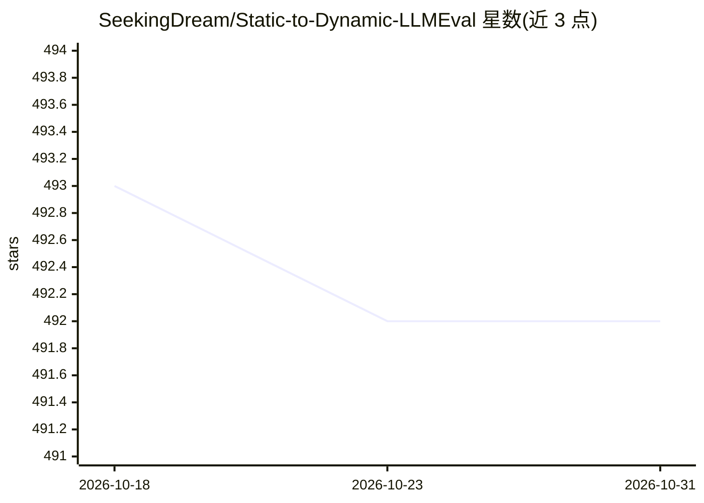

# SeekingDream/Static-to-Dynamic-LLMEval

⭐ 492 · 推送 2026-09-28 · [GitHub](https://github.com/SeekingDream/Static-to-Dynamic-LLMEval) · [官网](https://arxiv.org/abs/2502.17521) · 组织维护 · 中文 README

**LLM 数据污染评测综述的论文集仓库：静态到动态基准论文清单**

EMNLP 论文 "Recent advances in large language model benchmarks against data contamination" 的官方仓库，是一份持续维护的 survey 论文清单。内容按静态基准（数学/知识/编码/推理/安全等类别）、缓解方法（canary string、加密、标签保护、事后检测）与动态基准三大板块组织，收录各论文的标题、发表会议、论文与代码链接。社区可通过 pull request 提交新论文条目，作者来自哥伦比亚大学、新加坡国立大学、北大、清华等多所高校。

## 筛选速览

| 维度 | 判定 | 备注 |
|---|---|---|
| AI 角色 | `ai-knowledge` | 知识聚合/清单类 |
| 许可风险 | `none` | — |
| 部署形态 | `None` |  |
| 模型依赖 | — | README 未给出锁定关系 |
| 硬件要求 | — | 无带数字的原话,不猜 |
| 安装摩擦 | `low` | 无编译、无系统依赖或容器化 |
| 成熟度 | — | 结构信号不足 |

## 能力要点

- 覆盖静态基准、污染缓解方法与动态基准三大类别的论文清单
- 按 Math/Knowledge/Coding/Reasoning/Safety 等主题分类组织条目
- 社区可通过 PR 按指定 markdown 格式补充新论文
- EMNLP 主会议 camera-ready 之外的更新以此仓库为准

## 适用场景

- 查找 LLM 评测与数据污染方向的论文及配套代码
- 了解从静态到动态基准评测的研究脉络
- 为动态基准设计寻找论文中提出的设计原则

## 场景标签

`精选清单` · 领域:学习与行业

## 证据(README 行号)

> L38: Data contamination has received increasing attention in the era of large language models (LLMs) due to their relian
> L42: Data contamination occurs when benchmark data is inadvertently included in the training phase of language models, l
> L56: - Training Verifiers to Solve Math Word Problems, <ins>arXiv, 2021</ins> [Paper] [Code]

## 星数曲线

2026-10-18 493 → 2026-10-31 492（-1）

---
*卡片 v1 · prompt 1.4 · 生成 2026-10-22 · 置信度 high · 依据 README sha `8553aee4f28a` · [字段定义](../../DATASET.md)*
