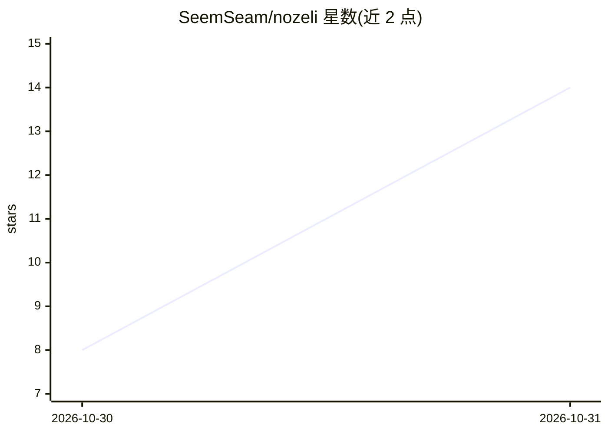

# SeemSeam/nozeli

⭐ 14 · JavaScript · AGPL-3.0 · 推送 2026-10-30 · [GitHub](https://github.com/SeemSeam/nozeli) · 个人维护 · 中文 README

**Agent 协作编辑工作台：阅读、批注、编辑与任务审阅闭环**

基于 Electron 的桌面文档工作台，供人与 AI Agent 围绕同一份材料协作：打开本地项目目录，通过选区、涂鸦等锚点就地发起讨论，支持人工直接编辑与批注、Agent 协助修改并显示作者。采用前台—调度（中枢）—专家多 Agent 模式，后台任务以可阅读的 HTML 报告交付，配合待办形成报告—审阅—修改—接受的闭环；支持拖动标签分屏与独立窗口。自有代码 AGPL-3.0-only，当前为 Linux x64（Wayland/X11）已验证的 Alpha 预发行版，Windows/macOS 未验证，第三方再分发审计未完成。

## 筛选速览

| 维度 | 判定 | 备注 |
|---|---|---|
| AI 角色 | `ai-enhanced` | 去掉 AI 部分产品仍成立 |
| 许可风险 | `viral` | AGPL-3.0 |
| 部署形态 | `None` |  |
| 模型依赖 | — | README 未给出锁定关系 |
| 硬件要求 | — | 无带数字的原话,不猜 |
| 安装摩擦 | `low` | 无编译、无系统依赖或容器化 |
| 成熟度 | `idea` | |

## 能力要点

- 以对话锚点（选区/涂鸦/框选）在文档位置就地发起讨论
- 前台—中枢—专家多 Agent 协作，后台任务以 HTML 报告交付
- 报告—审阅—修改—接受的任务闭环与批注机制
- 分屏工作区与独立窗口，集成多种编辑器（PDF.js、Monaco 等）

## 适用场景

- 与 Agent 围绕项目文档共同编辑与修订
- 审阅 Agent 后台任务的报告并接受或修改成果
- 在文档选区上直接批注讨论，替代聊天框来回搬运

## 场景标签

`多智能体` · 领域:Agent 开发

## 证据(README 行号)

> L7: **Agent 协作编辑工作台**
> L9: 协调你与 Agent 的协作节奏，让你看懂结果、参与修改，持续掌握项目进展。

## 星数曲线

2026-10-30 8 → 2026-10-31 14（+6）

---
*卡片 v1 · prompt 1.4 · 生成 2026-10-31 · 置信度 mid · 依据 README sha `320ef4c9ea68` · [字段定义](../../DATASET.md)*
