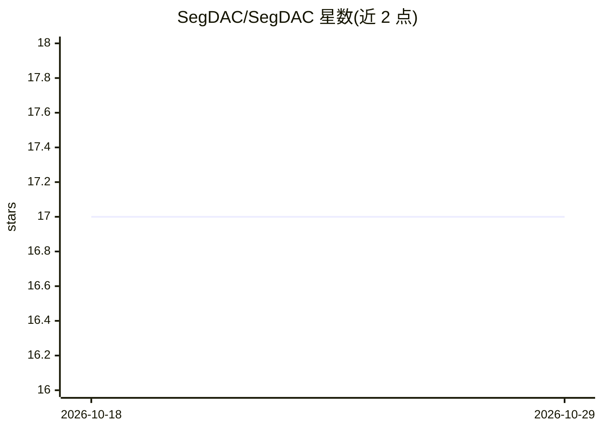

# SegDAC/SegDAC

⭐ 17 · Jupyter Notebook · MIT · 推送 2026-03-13 · [GitHub](https://github.com/SegDAC/SegDAC) · [官网](http://segdac.github.io/) · 组织维护

**强化学习视觉泛化方法 SegDAC 的官方 PyTorch 实现**

论文 SegDAC: Visual Generalization in Reinforcement Learning via Dynamic Object Tokens 的官方 PyTorch 实现与资源，面向机器人操作强化学习研究者。核心方法代码在 segdac/ 目录，依赖最少（主要为 PyTorch 与 TensorDict）；训练管线在 segdac_dev/，基于 ManiSkill3 仿真环境训练 SAC 等算法，另含 DDPG/TD3/DrqV2/SAM-G 等基线与视觉泛化基准测试脚本。评估与测试结果以 JSON 形式附带，可不重训直接对比。前置要求为 Miniconda 与支持 Vulkan 的 GPU，通过 conda 环境与 setup.sh 脚本安装运行。

## 筛选速览

| 维度 | 判定 | 备注 |
|---|---|---|
| AI 角色 | `ai-native` | 本体是模型或模型工具 |
| 许可风险 | `permissive` | MIT |
| 部署形态 | `None` |  |
| 模型依赖 | — | README 未给出锁定关系 |
| 硬件要求 | — | 无带数字的原话,不猜 |
| 安装摩擦 | `low` | 无编译、无系统依赖或容器化 |
| 成熟度 | — | 结构信号不足 |

## 能力要点

- 核心方法代码仅依赖 PyTorch 与 TensorDict，与训练/测试管线解耦
- 附带 1M 训练步后的最终测试结果 JSON，可不重训复现对比
- 包含 DDPG/TD3/SAC/DrqV2/MaDi/SADA/FTD/SAM-G/SMG 等基线
- 提供视觉泛化基准测试脚本（scripts/test_visual_generalization.py）

## 适用场景

- 复现论文的视觉泛化强化学习训练与测试结果
- 在 ManiSkill3 操作任务上对比基线算法的样本效率
- 复用附带结果 JSON 直接与 SegDAC 对比而无需重训

## 场景标签

`强化学习` · 领域:训练与推理

## 证据(README 行号)

> L34:  Official PyTorch implementation and resources for SegDAC
> L42: - Core method code is located under `segdac/`, this code is agnostic to the training and testing pipeline and requi
> L53: ## Prerequisites

## 星数曲线

2026-10-18 17 → 2026-10-29 17（+0）

---
*卡片 v1 · prompt 1.4 · 生成 2026-10-29 · 置信度 high · 依据 README sha `92ad15f87a5e` · [字段定义](../../DATASET.md)*
