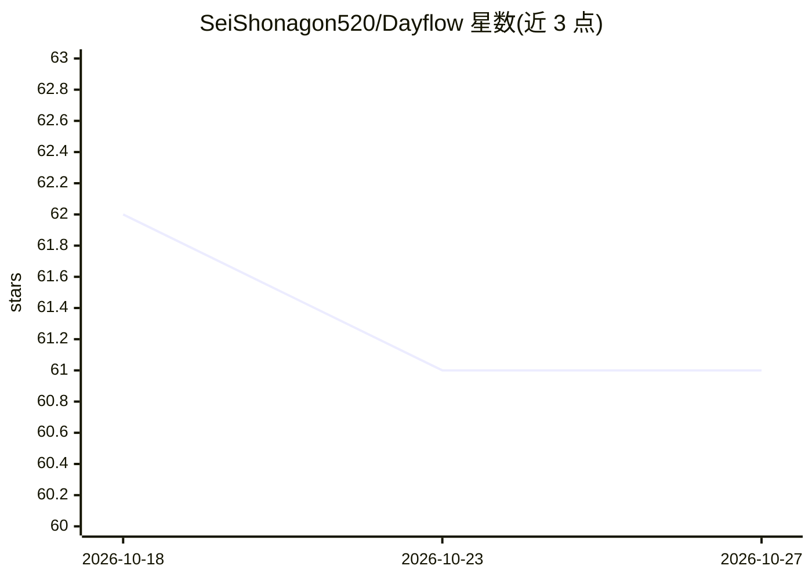

# SeiShonagon520/Dayflow

⭐ 61 · Python · NOASSERTION · 推送 2026-10-24 · [GitHub](https://github.com/SeiShonagon520/Dayflow) · 个人维护 · 中文 README

**Windows AI 时间追踪工具：后台录屏，视觉模型自动分析时间去向**

基于 PySide6 的 Windows 桌面应用：以 1 FPS 静默录制屏幕与窗口信息（Windows API 采集应用名和标题），每 60 秒生成视频切片，仅提取少量关键帧发送到用户配置的 OpenAI 兼容视觉模型（支持 DeepSeek、Ollama 本地模型等）进行活动识别与分类（工作/学习/娱乐/社交/休息），结果存入本地 SQLite。提供时间轴、统计面板、日报缓存、Web 仪表盘、邮件日报与 CSV 导出。仅支持 Windows 10/11，需 FFmpeg，识别质量依赖所配置的视觉模型，许可证为 CC BY-NC-SA 4.0（禁商业使用）。灵感源于 Dayflow (macOS) 项目。

## 筛选速览

| 维度 | 判定 | 备注 |
|---|---|---|
| AI 角色 | `ai-native` | 本体是模型或模型工具 |
| 许可风险 | `none` | NOASSERTION |
| 部署形态 | `desktop` | 安装包/桌面程序 |
| 模型依赖 | — | README 未给出锁定关系 |
| 硬件要求 | — | 无带数字的原话,不猜 |
| 安装摩擦 | `medium` | 含编译或系统依赖之一 |
| 成熟度 | — | 结构信号不足 |

## 能力要点

- 1 FPS 低功耗后台录屏 + 关键帧提取（每切片最多 8 帧）送视觉模型分析
- 自动活动分类：工作/学习/娱乐/社交/休息，附生产力评分
- 本地存储：切片分析后自动清理，数据存本地 SQLite
- 时间轴、统计面板、日报缓存、HTML 仪表盘、邮件日报、CSV 导出

## 适用场景

- 想了解自己一天时间都花在哪里，做自动化时间追踪
- 复盘专注时段、分心模式与工作节奏，生成日报/周报素材
- 多显示器环境下记录全屏活动并查看可视化统计

## 场景标签

 · 领域:生产力工具/时间追踪

## 证据(README 行号)

> L18: **Dayflow** 是一款面向 Windows 的 AI 时间追踪工具。它在后台低频记录你的屏幕与窗口信息，通过视觉模型分析你正在做什么，并生成清晰的时间轴、统计面板与日报，帮你更客观地理解时间都花在了哪里。
> L77: |🤖 **AI 智能分析**|视觉大模型识别屏幕活动，自动归类|

## 星数曲线

2026-10-18 62 → 2026-10-27 61（-1）

---
*卡片 v1 · prompt 1.4 · 生成 2026-10-24 · 置信度 mid · 依据 README sha `28d58896cab3` · [字段定义](../../DATASET.md)*
