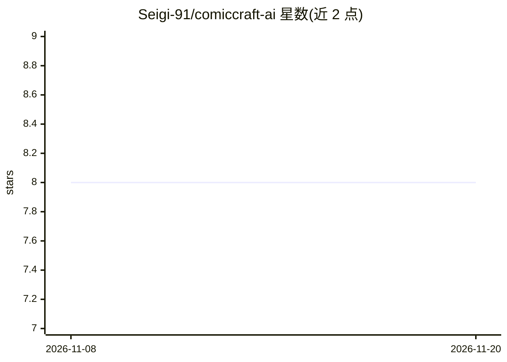

# Seigi-91/comiccraft-ai

⭐ 8 · Python · MIT · 推送 2026-11-04 · [GitHub](https://github.com/Seigi-91/comiccraft-ai) · [官网](https://seigi-91.github.io/comiccraft-ai/) · 个人维护 · 中文 README

**面向漫画创作者的本机 AI 漫画工作室，支持编辑与回退**

本机运行的漫画创作网站：从小说导入、角色档案、分镜，到多 Agent 生成连贯漫画、画内气泡编辑、蒙版局部精修与章节版本恢复。基于 React + FastAPI + LangGraph + SQLite + Pillow，六个 Agent 分工（剧情、分镜、台词、画面、审核、排版）。文字/视觉与图片模型连接分开配置，默认使用官方 ChatGPT 自动连接器，也可填 OpenAI 兼容 API。完整创作需在本机运行；公开仓库仅提供源码、文档与成稿。导入示例不调用模型；未声称验证模型生成质量。

## 筛选速览

| 维度 | 判定 | 备注 |
|---|---|---|
| AI 角色 | `ai-native` | 本体是模型或模型工具 |
| 许可风险 | `permissive` | MIT |
| 部署形态 | `desktop` | 安装包/桌面程序 |
| 模型依赖 | — | README 未给出锁定关系 |
| 硬件要求 | — | 无带数字的原话,不猜 |
| 安装摩擦 | `low` | 无编译、无系统依赖或容器化 |
| 成熟度 | — | 结构信号不足 |

## 能力要点

- 六个 Agent 结构化输出协作，LangGraph 编排创作流程
- 画内气泡编辑与蒙版局部精修，未选区像素保持不变
- 章节级版本备份，可恢复台词、图片、气泡与特效状态
- 文字/视觉与图片模型连接独立配置，密钥不回显

## 适用场景

- 把小说章节改编为带分镜和对白的漫画
- 在原画上直接编辑气泡、改字并重新合成成稿
- 圈选局部重绘并对比候选后决定是否采用
- 本机管理逐格生成记录与章节批次任务

## 场景标签

`图像生成` · 领域:内容生成

## 证据(README 行号)

> L14: 从创作灵感、角色档案和分镜，到连贯漫画、可编辑气泡与局部精修。基于 **React + FastAPI + LangGraph + SQLite + Pillow**，面向本机创作和可审阅的人机协作。
> L54: |六个 Agent|剧情策划、分镜、台词、画面设计、视觉审核、排版；明确职责和结构化输出|
> L98: 文字采用 OpenAI 兼容 `/chat/completions`，视觉模型还须支持图片输入；图片使用 `/images/generations`，有参考图或蒙版时需支持 `/images/edits`。不是每家供应商的私有协议

## 星数曲线

2026-11-08 8 → 2026-11-20 8（+0）

---
*卡片 v1 · prompt 1.4 · 生成 2026-11-20 · 置信度 mid · 依据 README sha `5d2b580e912d` · [字段定义](../../DATASET.md)*
