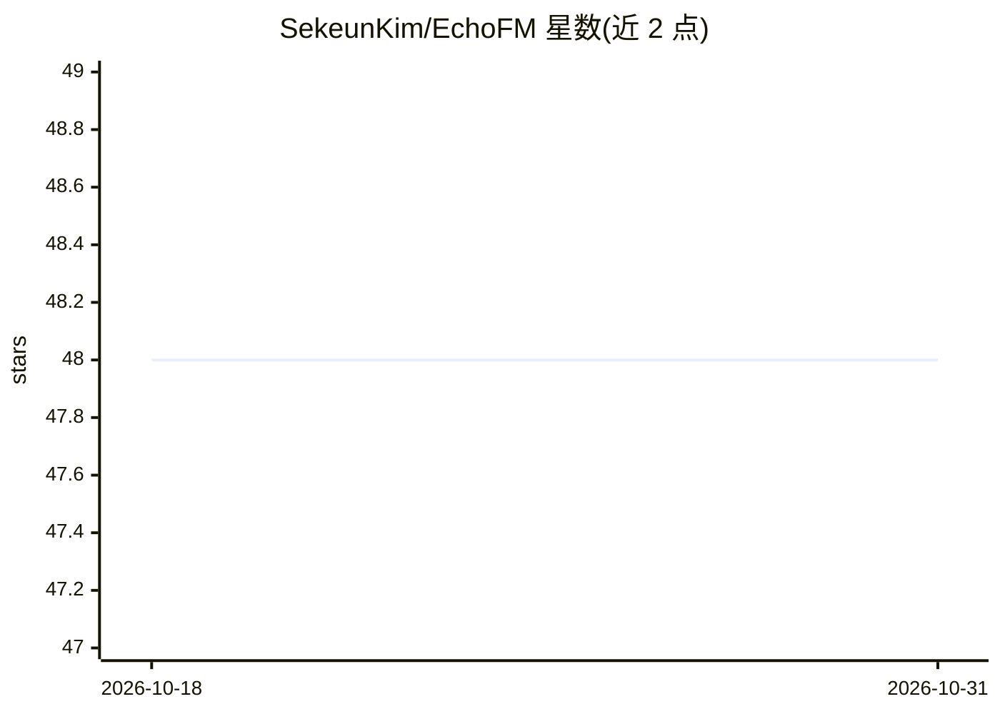

# SekeunKim/EchoFM

⭐ 48 · Jupyter Notebook · 推送 2026-08-15 · [GitHub](https://github.com/SekeunKim/EchoFM) · [官网](https://sekeunkim.github.io) · 组织维护

**给医学AI研究者：超声心动图视频基础模型，产出跨任务表征**

EchoFM 是一个 ViT-L 视频基础模型，在 29 万条超声心动图片段上以自监督方式预训练，目标围绕心动周期设计：掩码重建（全视频共享空间掩码）加周期对比学习（同相位帧拉近、反相位帧推远），无需 ECG、ED/ES 标签或分割。预训练编码器输出视频/帧/token 级表征，可迁移到分割、分类与疾病检测任务，可用轻量头或微调适配。面向医学影像研究者，权重托管于 Hugging Face，提供安装脚本、使用 notebook 与预训练/测试脚本，采用 CC-BY-NC-ND 4.0 许可（禁商用、禁演绎）。

## 筛选速览

| 维度 | 判定 | 备注 |
|---|---|---|
| AI 角色 | `ai-native` | 本体是模型或模型工具 |
| 许可风险 | `none` | — |
| 部署形态 | `None` |  |
| 模型依赖 | — | README 未给出锁定关系 |
| 硬件要求 | — | 无带数字的原话,不猜 |
| 安装摩擦 | `medium` | 含编译或系统依赖之一 |
| 成熟度 | — | 结构信号不足 |

## 能力要点

- 周期感知自监督预训练，无需 ECG 或 ED/ES 标签
- 在 290K 超声心动图片段上预训练
- 编码器产出视频/帧/token 级表征，迁移到分割、分类、疾病检测
- 提供 Hugging Face 权重、使用 notebook 与 SLURM/apptainer 启动脚本

## 适用场景

- 我在做超声心动图分割或疾病检测，想用预训练编码器提特征
- 我想在自己的超声视频数据上复现或继续自监督预训练
- 我想验证嵌入空间是否编码了心动周期相位结构

## 场景标签

`模型训练` · 领域:训练与推理

## 证据(README 行号)

> L9: EchoFM is a ViT-L video foundation model pretrained on echocardiogram clips with a
> L19: phase. The pretrained encoder produces video-, frame-, and token-level representations
> L30: - **Validated downstream.** Segmentation, classification, and disease detection; the

## 星数曲线

2026-10-18 48 → 2026-10-31 48（+0）

---
*卡片 v1 · prompt 1.4 · 生成 2026-10-25 · 置信度 high · 依据 README sha `d5a4b62584f9` · [字段定义](../../DATASET.md)*
