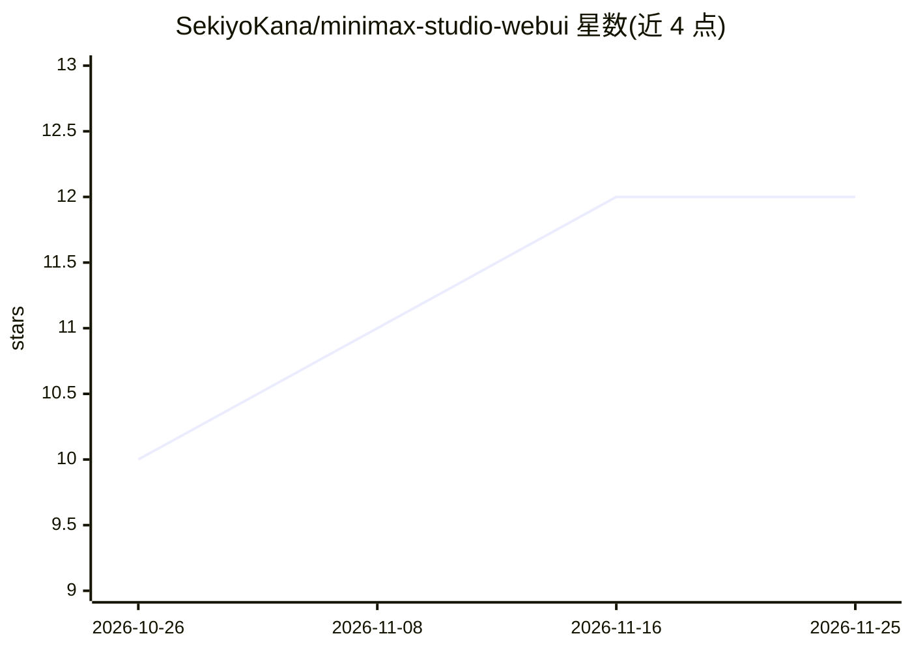

# SekiyoKana/minimax-studio-webui

⭐ 12 · Python · MIT · 推送 2026-10-23 · [GitHub](https://github.com/SekiyoKana/minimax-studio-webui) · 个人维护 · 中文 README

**MiniMax H3 视频/音频生成的统一网页与 API 控制服务**

以 Python 3.11 + FastAPI 实现的控制服务，为 MiniMax H3 视频、H3 TTS、数字人、Music3 与 RunningHub 工作流提供统一网页界面、HTTP API、桌面入口与 Android 远程客户端。内置任务队列、多 ComfyUI 节点调度、checkpoint 恢复、素材库管理与工作流导入同步；提供云 GPU 安装脚本按显存档位部署模型，并公开 AGENT.md 与 OpenAPI 供 Agent 接入。仓库不含模型权重，Android 客户端为 Beta 且未经实机验证。

## 筛选速览

| 维度 | 判定 | 备注 |
|---|---|---|
| AI 角色 | `ai-native` | 本体是模型或模型工具 |
| 许可风险 | `permissive` | MIT |
| 部署形态 | `desktop` | 安装包/桌面程序 |
| 模型依赖 | — | README 未给出锁定关系 |
| 硬件要求 | `gpu-8g` | |
| 安装摩擦 | `medium` | 含编译或系统依赖之一 |
| 成熟度 | — | 结构信号不足 |

## 能力要点

- 内置 FL2VA、Ref2VA、8 步 LoRA、H3 SA、VDN H3、数字人、Music3 等工作流
- 持久化任务队列、多节点调度、checkpoint 恢复与实时进度
- 支持导入 ComfyUI API 格式自定义工作流并同步到节点
- macOS/Windows 桌面打包与 Android 远程客户端（Beta）

## 适用场景

- 通过网页界面批量生成 MiniMax H3 视频与音频
- 用自有 ComfyUI 工作流接入统一的生成任务队列
- 手机远程提交任务并下载生成结果

## 场景标签

`语音合成` `视频生成` · 领域:内容生成

## 证据(README 行号)

> L16: MiniMax H3 Studio 为 MiniMax H3、H3 TTS、数字人、Music3 和通用 RunningHub 工作流提供统一的网页界面、HTTP API、桌面入口与 Android 远程客户端。服务负责请求校验、
> L27: |视频生成|FL2VA、Ref2VA、8 步 LoRA、双阶段采样、H3 SA、VDN H3、数字人和 H3 NSFW|
> L270: Linux 和 Windows PC 使用同一套安装逻辑及配套资源包。Linux 使用 Python 安装脚本和资源 ZIP；Windows 使用 PowerShell 脚本和资源 ZIP，BAT 文件提供双击入口。运行后输入目

## 星数曲线

2026-10-26 10 → 2026-11-25 12（+2）

---
*卡片 v1 · prompt 1.4 · 生成 2026-11-18 · 置信度 high · 依据 README sha `e89696f2c399` · [字段定义](../../DATASET.md)*
