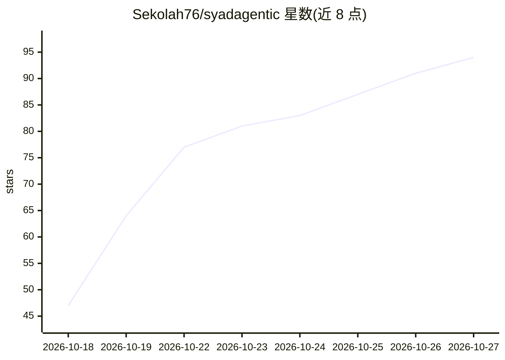

# Sekolah76/syadagentic

⭐ 94 · Python · MIT · 推送 2026-08-26 · [GitHub](https://github.com/Sekolah76/syadagentic) · [官网](https://github.com/Sekolah76/syadagentic) · 个人维护

**零拒绝 AI agent 框架：越狱模板与自动化/安全技能集**

面向多平台 agent（Hermes、Claude Code、Codex、opencode、OpenAI 兼容 API）的通用框架仓库：以 SOUL.md 系统提示、40+ 越狱/提示注入模板（T1–T119）、千余条技能（安全测试、farming 流水线、设计与文案等）与可执行 framework-core（phase-engine、governor、captcha-harvester 等）组成。通过 bash install.sh 安装或手动复制配置文件；仅要求 Python 3.8+ 与 curl。README 声明对前沿模型服务端过滤无效，限授权安全研究使用。

## 筛选速览

| 维度 | 判定 | 备注 |
|---|---|---|
| AI 角色 | `ai-ecosystem` | LLM/agent 周边工具 |
| 许可风险 | `permissive` | MIT |
| 部署形态 | `None` |  |
| 模型依赖 | — | README 未给出锁定关系 |
| 硬件要求 | — | 无带数字的原话,不猜 |
| 安装摩擦 | `low` | 无编译、无系统依赖或容器化 |
| 成熟度 | — | 结构信号不足 |

## 能力要点

- 40+ 越狱/提示注入模板（T1–T119）与 Verified Strategy Matrix
- 可执行 framework-core：phase-engine、governor（spend-cap/kill-switch）、captcha-harvester
- bash install.sh 自动检测并适配 Hermes/Claude Code/Codex/opencode
- 1128 条技能，含 627 条 bug-bounty/渗透测试技能

## 适用场景

- 在自有或已授权目标上做安全测试与 LLM 红队研究
- 为多种 agent 平台统一配置执行型系统提示与技能集
- 搭建批量自动化流水线（cron、webhook、批量任务）

## 场景标签

`Agent 框架` `网络安全` · 领域:Agent 开发

## 证据(README 行号)

> L18: **SYADAGENTIC** adalah framework universal yang mengubah AI agent (Claude, GPT, Gemini, DeepSeek, atau model open-w
> L52: bash install.sh          # deteksi otomatis Hermes/Claude/Codex/opencode
> L135: |Hermes Agent|✅ Native (install.sh)|

## 星数曲线

2026-10-18 47 → 2026-10-27 94（+47）

---
*卡片 v1 · prompt 1.4 · 生成 2026-10-24 · 置信度 high · 依据 README sha `3541e13b7778` · [字段定义](../../DATASET.md)*
