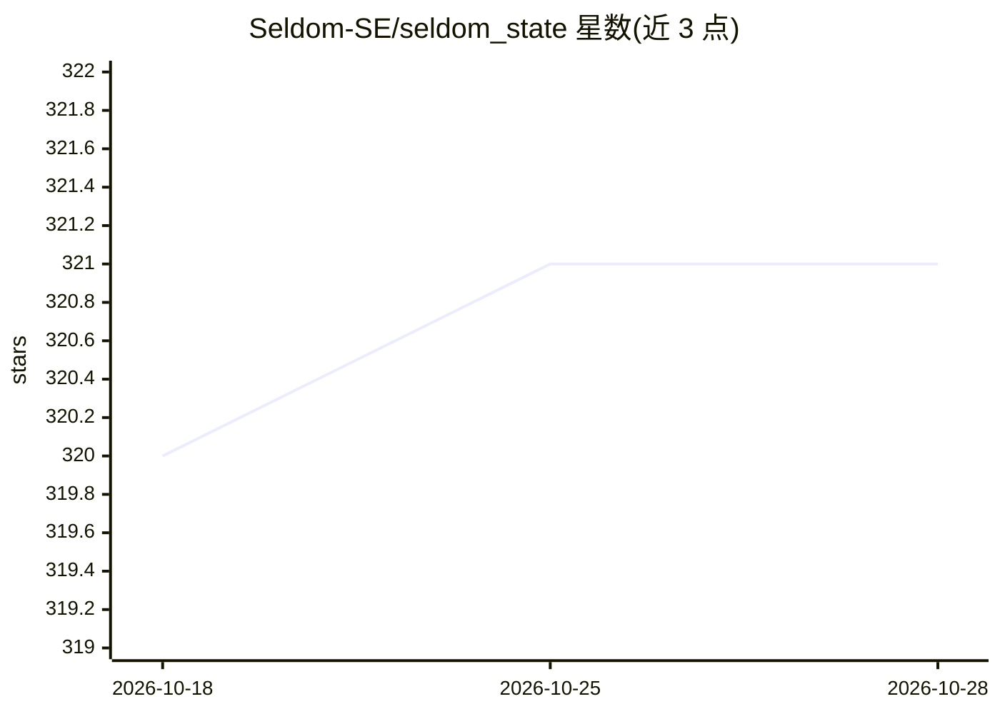

# Seldom-SE/seldom_state

⭐ 321 · Rust · Apache-2.0 · 推送 2026-04-02 · [GitHub](https://github.com/Seldom-SE/seldom_state) · 个人维护

**Bevy 引擎的组件式有限状态机插件，用于游戏实体状态管理**

面向 Bevy 游戏开发者的 Rust 状态机插件：以组件方式为实体挂载状态（如 Jumping/Stunned），通过触发器（Trigger）与转换（Transition）定义状态切换，状态机组件自动管理状态变化。提供 30 个内置触发器（含 leafwing_input 特性启用的 24 个输入类触发器）、布尔组合触发器、进入/退出状态回调与转换构建器。README 讨论了与 big-brain 的适用差异：本插件面向离散转换，非模糊逻辑。游戏 AI 是其用途之一，也用于玩家状态与动画管理。通过 Cargo.toml 依赖安装。

## 筛选速览

| 维度 | 判定 | 备注 |
|---|---|---|
| AI 角色 | `ai-enhanced` | 去掉 AI 部分产品仍成立 |
| 许可风险 | `permissive` | Apache-2.0 |
| 部署形态 | `library` | 以包/库形式分发 |
| 模型依赖 | — | README 未给出锁定关系 |
| 硬件要求 | — | 无带数字的原话,不猜 |
| 安装摩擦 | `low` | 无编译、无系统依赖或容器化 |
| 成熟度 | — | 结构信号不足 |

## 能力要点

- 组件式状态机，状态/触发器/转换三层抽象
- 30 个内置触发器，支持布尔逻辑组合（Not/And/Or）
- AnyState/OneOfState/NotState 状态组匹配
- on_enter/on_exit 回调与转换构建器支持数据传递

## 适用场景

- 游戏敌人或玩家角色的行为状态管理
- 根据行为状态切换实体动画
- 多个独立状态并存时拆分为多个状态机（如移动+攻击）

## 场景标签

 · 领域:游戏开发/引擎插件

## 证据(README 行号)

> L7: `seldom_state` is a component-based state machine plugin for Bevy. It's useful for AI, player state,
> L79: `seldom_state` is not just an AI crate, though. So, you may want to use `big-brain` for your

## 星数曲线

2026-10-18 320 → 2026-10-28 321（+1）

---
*卡片 v1 · prompt 1.4 · 生成 2026-10-21 · 置信度 mid · 依据 README sha `5d82ab1cc434` · [字段定义](../../DATASET.md)*
