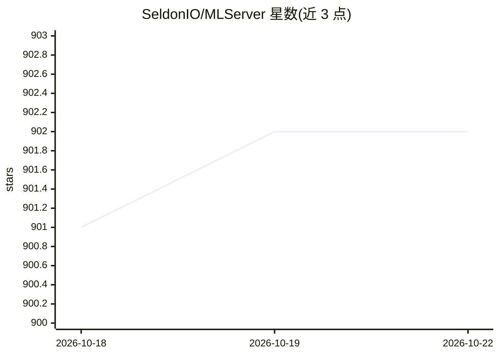

# SeldonIO/MLServer

⭐ 902 · Python · Apache-2.0 · 推送 2026-10-20 · [GitHub](https://github.com/SeldonIO/MLServer) · [官网](https://mlserver.readthedocs.io/en/latest/) · 组织维护

**开源机器学习模型推理服务器：REST/gRPC 多框架多模型服务**

MLServer 是面向机器学习模型的推理服务器，通过 REST 与 gRPC 接口提供推理服务，实现 KFServing V2 Dataplane 规范。支持多模型服务（同进程运行多个模型）、并行推理工作池、自适应批处理，以及通过 Seldon Core 和 KServe 在 Kubernetes 中部署。开箱内置 Scikit-Learn、XGBoost、LightGBM、MLflow、HuggingFace 等推理运行时，也支持编写自定义运行时。以 pip 安装的 Python 包形式提供，需按所用框架另装对应 runtime 包。

## 筛选速览

| 维度 | 判定 | 备注 |
|---|---|---|
| AI 角色 | `ai-ecosystem` | LLM/agent 周边工具 |
| 许可风险 | `permissive` | Apache-2.0 |
| 部署形态 | `library` | 以包/库形式分发 |
| 模型依赖 | — | README 未给出锁定关系 |
| 硬件要求 | — | 无带数字的原话,不猜 |
| 安装摩擦 | `low` | 无编译、无系统依赖或容器化 |
| 成熟度 | — | 结构信号不足 |

## 能力要点

- REST/gRPC 接口，符合 KFServing V2 Dataplane 规范
- 多模型服务与并行推理工作池、自适应批处理
- 内置 Scikit-Learn/XGBoost/LightGBM/MLflow/HuggingFace 等推理运行时，支持自定义运行时
- 作为 Seldon Core 与 KServe 的核心 Python 推理服务器

## 适用场景

- 把 sklearn、XGBoost 等训练好的模型部署为在线推理服务
- 同一进程内服务多个模型以节省资源
- 在 Kubernetes 上通过 KServe/Seldon Core 扩展部署模型

## 场景标签

`推理引擎` · 领域:训练与推理

## 证据(README 行号)

> L3: An open source inference server for your machine learning models.
> L9: MLServer aims to provide an easy way to start serving your machine learning
> L25:  MLServer is the core Python inference server used to serve machine learning

## 星数曲线

2026-10-18 901 → 2026-10-22 902（+1）

---
*卡片 v1 · prompt 1.4 · 生成 2026-10-21 · 置信度 high · 依据 README sha `597c9859d7a4` · [字段定义](../../DATASET.md)*
