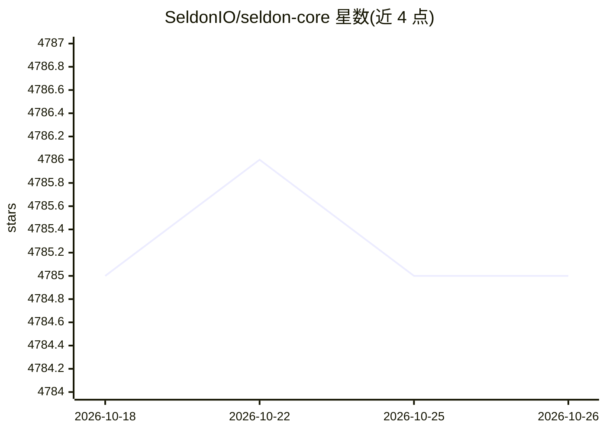

# SeldonIO/seldon-core

⭐ 4,785 · Go · NOASSERTION · 推送 2026-03-23 · [GitHub](https://github.com/SeldonIO/seldon-core) · [官网](https://www.seldon.io/solutions/core/) · 组织维护

**Kubernetes 上部署、管理与扩缩 ML/LLM 模型的 MLOps 框架**

Seldon Core 2 是面向 Kubernetes 的 MLOps/LLMOps 框架，用于以标准化方式部署、管理和扩缩生产级 AI 系统，覆盖单一模型到模块化、以数据为中心的应用，支持本地数据中心或任意云环境。功能包括基于 Kafka 的流水线实时数据流、模型与组件自动扩缩、多模型共享推理服务器的合并部署、超额部署模型、A/B 测试与影子部署的实验路由，以及自定义组件（含漂移/离群检测与 LLM）。采用 Business Source License 分发，商业使用需联系 Seldon。

## 筛选速览

| 维度 | 判定 | 备注 |
|---|---|---|
| AI 角色 | `ai-ecosystem` | LLM/agent 周边工具 |
| 许可风险 | `none` | NOASSERTION |
| 部署形态 | `None` |  |
| 模型依赖 | — | README 未给出锁定关系 |
| 硬件要求 | — | 无带数字的原话,不猜 |
| 安装摩擦 | `low` | 无编译、无系统依赖或容器化 |
| 成熟度 | — | 结构信号不足 |

## 能力要点

- 基于 Kafka 的可组合 AI 应用流水线部署
- 多模型服务与超额部署以节省基础设施成本
- A/B 测试与影子部署的模型实验路由
- 自动扩缩与自定义组件扩展机制

## 适用场景

- 在 Kubernetes 上标准化部署生产 ML 模型
- 构建由多模型组件组成的数据流 AI 应用
- 通过 A/B 与影子部署在线对比候选模型

## 场景标签

`MLOps` · 领域:训练与推理

## 证据(README 行号)

> L8: Seldon Core 2 is an MLOps and LLMOps framework for deploying, managing and scaling AI systems in Kubernetes - from s
> L29:  * **Pipelines**: Deploy composable AI applications, leveraging Kafka for realtime data streaming between component

## 星数曲线

2026-10-18 4,785 → 2026-10-26 4,785（+0）

---
*卡片 v1 · prompt 1.4 · 生成 2026-10-20 · 置信度 high · 依据 README sha `2f67116f9b10` · [字段定义](../../DATASET.md)*
