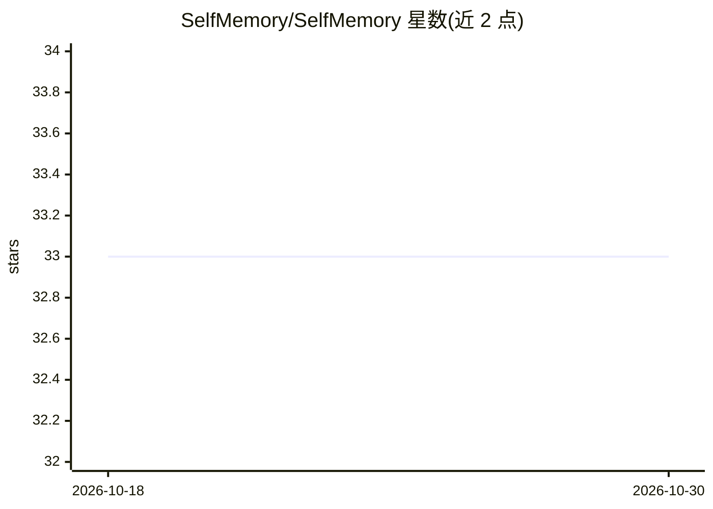

# SelfMemory/SelfMemory

⭐ 33 · Python · Apache-2.0 · 推送 2026-10-29 · [GitHub](https://github.com/SelfMemory/SelfMemory) · [官网](https://selfmemory.com) · 组织维护

**为用户与 AI agent 提供跨模型记忆存储与检索的开源引擎**

开源的通用记忆引擎（Python 库），支持存储和检索 AI 对话与上下文，记忆可跨不同模型使用。接入方式包括 MCP、SDK 与 selfmemory.com 网站；面向个人用户可作为记忆中枢，面向 B2B 场景可作为知识骨干，存储项目上下文、组织知识、文档与数据源以支撑企业级 AI 系统。README 声明其将逐步演进为集笔记与聊天机器人功能的一站式记忆中心。以 pip 安装，文档见 docs.selfmemory.com。

## 筛选速览

| 维度 | 判定 | 备注 |
|---|---|---|
| AI 角色 | `ai-ecosystem` | LLM/agent 周边工具 |
| 许可风险 | `permissive` | Apache-2.0 |
| 部署形态 | `library` | 以包/库形式分发 |
| 模型依赖 | — | README 未给出锁定关系 |
| 硬件要求 | — | 无带数字的原话,不猜 |
| 安装摩擦 | `low` | 无编译、无系统依赖或容器化 |
| 成熟度 | — | 结构信号不足 |

## 能力要点

- 跨模型存储与检索 AI 对话和上下文
- 支持 MCP、SDK、selfmemory.com 网站三种记忆添加方式
- B2B 场景作为组织知识与项目上下文的知识骨干

## 适用场景

- 让 AI 助手在不同模型间保留我的对话记忆
- 团队用统一记忆库存储项目上下文与组织知识
- 通过 MCP 把记忆能力接入 agent 工作流

## 场景标签

`Agent 记忆` · 领域:Agent 开发

## 证据(README 行号)

> L13: **Store AI memories for you and your agents**
> L15: It is a open-source universal memory engine where users can store and retrieve their AI conversations and context a

## 星数曲线

2026-10-18 33 → 2026-10-30 33（+0）

---
*卡片 v1 · prompt 1.4 · 生成 2026-10-26 · 置信度 high · 依据 README sha `8d71016595f3` · [字段定义](../../DATASET.md)*
